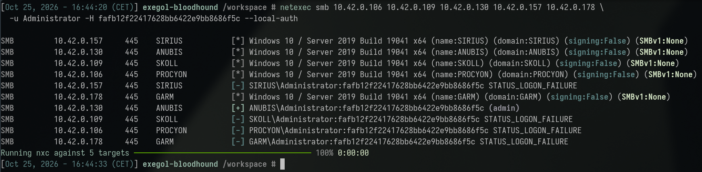
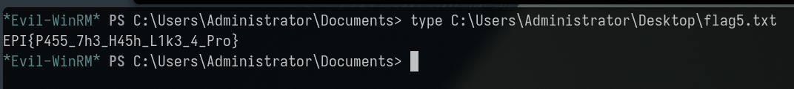

# The case of the shared master key

*A plain-English summary of the "Baton Passer" finding — no jargon
required.*

## What happened, in one sentence

Every computer in the company had its own local "master key" account, but
it turned out several of those computers were quietly using the **exact
same key** — so compromising one machine's key handed us the keys to
another machine entirely, without ever needing to know what the actual
password was.

## The setup

Every Windows computer has a built-in local "Administrator" account, separate
from the company-wide network login. In a well-run environment, each
computer's local Administrator password is unique and automatically rotated
— so even if one machine's key is somehow exposed, it only opens that one
machine.

We'd already gotten administrator access on one laptop (`ARGOS`) in an
earlier finding, through an employee who never changed their starter
password. Windows stores its local account credentials in a scrambled
("hashed") form internally. We pulled that scrambled form directly off the
laptop — but here's the key point: **we never actually had to unscramble
it.** Windows network logins accept that scrambled form directly as proof
of identity, the same way a key card doesn't care whether you memorized the
key card's internal code — just having the card works.

So we took that scrambled credential, as-is, and simply tried it against
every other computer in the company. It turned out a second machine
(`ANUBIS`) had been set up with the **identical** local Administrator
password — probably from a shared company image or template used when
setting up machines, never individualized afterward. The scrambled
credential from the first machine worked perfectly on the second.

## What we actually did

1. Took the scrambled local-admin credential we'd already pulled from the
   first compromised laptop.
2. Tried that exact scrambled value, unmodified, against every other
   computer on the network as a login attempt.
3. One other machine accepted it immediately and granted full
   administrator access — no password-cracking, no guessing, nothing
   needed beyond reusing the scrambled value directly.

4. Logged into that second machine and found a flag file confirming full
   compromise.

What "full compromise" looked like on screen (click to reveal)

## Why this is dangerous

- **You don't need the real password at all.** The scrambled form by
  itself is a fully valid credential for Windows network logins — treating
  it as "safe because it's encrypted" is a dangerous misunderstanding.
  Getting the scrambled version is functionally the same as getting the
  plaintext password.
- **One compromised machine can cascade into many.** If every computer in a
  fleet shares the same local-admin password (common when machines are set
  up from the same template and never individually hardened afterward),
  compromising *any single one* of them effectively compromises all of
  them.
- **It requires zero cracking skill or time.** This isn't a slow,
  resource-intensive attack — it's an instant, direct reuse of a credential
  already in hand. The only "work" involved was already done by the
  earlier finding that got us onto the first machine.
- **It's invisible without specifically looking for it.** Nothing about
  either machine's configuration, on its own, reveals that they share a
  password — it only becomes apparent by actually testing the stolen
  credential against other hosts.

## What should be fixed

- **Deploy a tool that randomizes and rotates each computer's local
  administrator password independently** (Microsoft's own built-in
  solution for this, LAPS, exists specifically to solve this problem, and
  it's free). This is the single fix that breaks this entire attack
  pattern at the root.
- **Never provision multiple machines from a template with the same local
  admin password baked in** without a follow-up process to individualize
  it immediately.
- **Treat any scrambled/hashed form of a credential with the same care as
  the plaintext password itself** — it should never be dismissed as "just
  a hash, not the real password."
- **Monitor for the same credential authenticating across many different
  hosts in a short time window** — a strong signal of exactly this
  technique in progress.

## Bottom line

Getting administrator access to one laptop turned into administrator access
on a second, completely unrelated laptop, purely because both machines
happened to share the same local administrator credential — and we never
needed to know what that credential actually was in readable form. This is
one of the most common, well-known lateral-movement techniques in Windows
environments, and it has a simple, well-established fix that most
organizations still haven't deployed everywhere.
