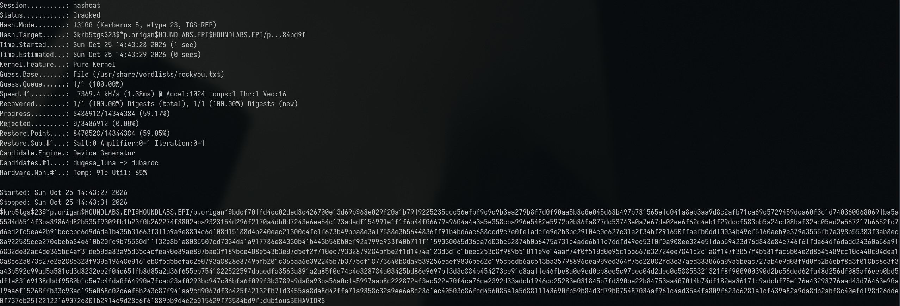
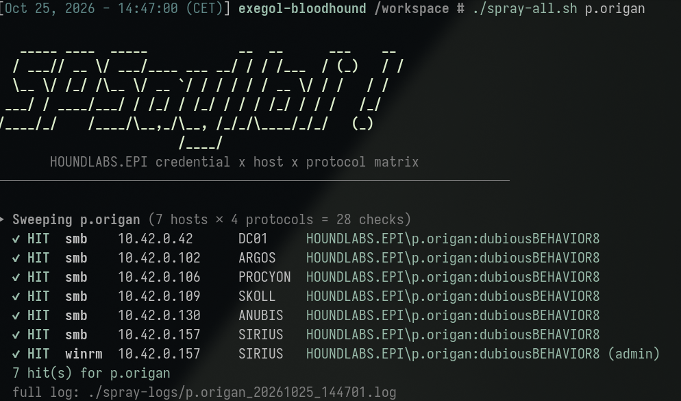
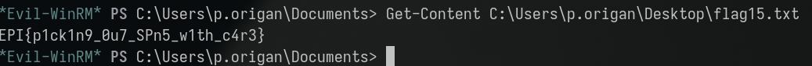

# The case of the self-issued keycard

*A plain-English summary of the "Service Changer" finding — no jargon required.*

## What happened, in one sentence

Because one employee had the ability to **edit a small detail on a colleague's
employee file**, we were able to temporarily give that colleague's account a
property it never had — and use that one edit to steal their password the
exact same way as in our earlier "Dangerous Services" finding, even though
they'd done nothing wrong and had no weakness of their own to begin with.

## The setup

This finding builds directly on our earlier one: **["The case of the 'juicy'
service account"](../dangerous_services/dangerous_services_casual.md)**. There,
an account was vulnerable because it already had a certain property (an SPN,
or "service tag") attached to it, and its password was weak enough that
stealing the tag's scrambled data let us crack the real password offline.

The natural follow-up question was: *what if an account doesn't have that
property at all — could we just add it ourselves?*

It turns out: yes, if you have the right kind of edit permission on that
account. Think of it like this — HR files in a company sometimes let certain
staff edit specific fields on a colleague's record (say, their job title)
without being able to edit the whole file. We found that one of our already-
compromised accounts (`g.clooney`, cracked in the earlier finding) had exactly
this kind of narrow edit permission over a second, completely unrelated
account (`p.origan`) — specifically, permission to add a "service tag" to it.

`p.origan` had never had this tag before and had done nothing to expose
themselves — the weakness here isn't a bad password on `p.origan`'s part at
all, it's a **misconfigured permission grant** that let another account write
a property onto them.

## What we actually did

1. Confirmed our already-stolen `g.clooney` credentials still worked.
2. Used a specialized tool to check: "does `g.clooney` have permission to add
   a service tag to any other account?" — the tool found `p.origan`.
3. The tool automatically: added a temporary service tag to `p.origan`,
   requested the scrambled ticket for that tag (exactly like the earlier
   finding), and printed it out — then removed the temporary tag again so the
   account was left in its original state.
4. Cracked the scrambled ticket offline using a common password list — it
   took seconds.
5. The recovered password worked to log into the same company server as
   before, this time as `p.origan`, with full administrative rights.
6. Found a second flag file on that server's desktop, confirming full
   compromise through this second, independent path.

What "full compromise" looked like on screen (click to reveal)

## Why this is dangerous

- **It turns "harmless" edit permissions into a credential-theft tool.** The
  permission in question looks minor on paper — "can edit one specific field
  on one other account" — but it's enough to manufacture a brand-new attack
  surface on an account that was otherwise completely secure.
- **The victim account did nothing wrong.** Unlike the first finding, `p.origan`
  didn't have a weak password *exposed* by a pre-existing property — the
  property was created purely by someone else's permission. Password strength
  reviews alone would never catch this.
- **It chains cleanly off the first weakness.** We only found this because we
  already had a foothold from the earlier incident, and the chain tool that
  attacked the first account was already looking for "what else can this
  account touch?" — this is exactly how real attackers escalate, one small
  foothold unlocking the next.
- **It's cleaned up after itself.** The attack tool removes the temporary
  property once it's done, so a casual look at the account afterward shows
  nothing out of place.

## What should be fixed

- **Audit who can edit what on every account**, not just who's a member of
  which group — narrow-looking edit permissions (like "can add a service tag")
  can be just as dangerous as broad admin rights if they're pointed at the
  wrong accounts.
- **Remove unnecessary edit rights between unrelated accounts.** There's
  rarely a legitimate business reason for one regular account to be able to
  modify another regular account's technical attributes.
- **Apply the same password-hardening fix as the first finding** (long,
  random, vaulted passwords) — it closes this path too, since the final step
  is still "crack a weak password offline."
- **Monitor for attribute changes themselves**, not just logins — a service
  tag appearing and then disappearing on an account in a short window is a
  strong signal this exact technique was used.

## Bottom line

A permission that looked small and reasonable on its own — "this account can
edit one field on that account" — turned into a second, independent path to
full server access, built entirely on top of our first finding. This is a
good example of why access reviews need to look at the whole chain of what an
account *can reach*, not just what it directly owns.
